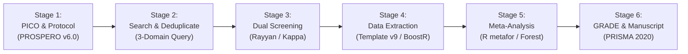

# Researcher Dóri — GP3 Universal Meta-Analysis Pipeline (UMAP) Architecture

> **Standard:** Centre for Translational Medicine (CTM / Semmelweis University) · Cochrane Handbook v6.5 · PRISMA 2020  
> **Updated:** 2026-10-28  

---

## 📋 System Overview

This workspace implements a **Universal Meta-Analysis Pipeline (UMAP)** designed to guide clinical researchers through the end-to-end lifecycle of a systematic review and meta-analysis — from clinical hypothesis to PROSPERO registration, literature screening, CTM BoostR extraction, biostatistical modeling, and publication-ready manuscript generation.



---

## 🤖 The 8 Canonical Research Agents

All generic software engineering personas have been archived. The system is operated strictly by **8 specialized clinical research agents**:

| Agent | Canonical Domain | Key Rules Enforced |
|---|---|---|
| **`orchestrator`** | Master Lifecycle Controller | Coordinates multi-agent workflows, enforces agent boundaries and phase gates. |
| **`research-sage`** | Principal Investigator | PICO Title Formula, Suffering Narrative, FINER, 1 Safety + 1 Efficacy outcome mandate. |
| **`lit-reviewer`** | Systematic Search Specialist | 3-Domain Search Keys, 5–10 precedent MA mining, ⛔ Boolean NOT ban, PROSPERO search & PDF export. |
| **`feasibility-judge`** | Clinical Logistics & Bias Guard | 70% missing variable rule, ecological bias red flag, PROSPERO timing & stage grid gate. |
| **`meta-analyzer`** | Biostatistician & Data Synthesizer | Poolability Rule ($\ge 3$ primary studies), Confounder Matrix, RoB 2 / QUIPS, RVE multilevel modeling, BoostR hygiene. |
| **`mentor-hegyi`** | Senior Translational Mentor | Bedside First, SAP, Avoidable Mortality calculation, 4D Clinical Matrix (1–10). |
| **`mentor-garami`** | Senior Physiological Conscience | Sensor-Pathway-Effector triad, ambient temperature ($T_a$), 4D Methodological Matrix (1–10). |
| **`documentation-writer`** | Medical Protocol Scribe | Compiles `PROTOCOL.md`, PROSPERO registration dossiers ([`PROSPERO_REGISTRATION_TEMPLATE.md`](file:///c:/Users/shuba/Desktop/Researcher%20-%20D%C3%B3ri/data/wiki/templates/PROSPERO_REGISTRATION_TEMPLATE.md)), GRADE SoF tables, and PRISMA 2020 manuscripts. |

---

## 🛠️ Master CLI Orchestration: `python src/run_pipeline.py`

The pipeline is operated via a single, universal command-line interface:

| Subcommand | Description | Example Usage |
|---|---|---|
| `new` | Scaffold a new standardized project workspace | `python src/run_pipeline.py new <project_slug>` |
| `status` | Inspect all active project workspaces and milestones | `python src/run_pipeline.py status` |
| `validate-protocol` | Run 7-Gate CTM Protocol Compliance Linter (score 0–100) | `python src/run_pipeline.py validate-protocol <path_to_protocol.md>` |
| `check-gate` | Verify deterministic phase gate readiness (Phases 2 to 6) | `python src/run_pipeline.py check-gate --target-phase <N>` |
| `search` | Execute live 3-domain PubMed search & white-spot audit | `python src/run_pipeline.py search "<query>" --analyze` |
| `screen` | Automated literature screening & inter-rater Kappa audit | `python src/run_pipeline.py screen --from-file <search.json>` |
| `audit-data` | Execute TRIPOD+AI data and modeling integrity audit | `python src/run_pipeline.py audit-data` |
| `verify-citations` | Verify PMIDs and bibliographic citations against PubMed | `python src/run_pipeline.py verify-citations <path_to_protocol.md>` |

---

## 📁 Standardized Project Directory Structure

Every meta-analysis project initiated in `projects/<project_slug>/` strictly follows this blueprint:

```
projects/<project_slug>/
├── PROJECT.md                           ◄── Project state, PICO, mentor scores, open questions
├── protocol/
│   ├── PROTOCOL.md                          Full 10-chapter CTM Protocol
│   ├── PROSPERO_DRAFT.md                    Field-by-field copy-paste PROSPERO draft
│   └── search_strategy.pdf                  Public search strategy for PROSPERO upload
├── literature/
│   ├── search_queries.json                  Raw search strings for PubMed, Embase, CENTRAL
│   ├── search_results.ris                   Combined deduplicated records
│   └── screening_records.csv                Screening decisions (R1, R2, Kappa)
├── data/
│   ├── Extraction_<slug>_Template_v9.xlsx   CTM Template v9 (14 worksheets)
│   └── study_dossiers/                      Markdown audit dossier for each included study
├── synthesis/
│   ├── meta_analysis.R                      Reproducible R script (metafor)
│   ├── forest_plots/                        Publication-ready TIFF/PNG figures
│   └── grade_sof_table.md                   GRADE Summary of Findings table
├── manuscript/
│   ├── MANUSCRIPT.md                        Publication-ready draft (PRISMA 2020)
│   └── figures_and_tables/                  Final vector graphics & Word tables
└── scripts/                                 ◄── Project-specific analysis scripts
```

---

## 📐 The 7 GP3 Protocol Compliance Gates (`validate_protocol.py`)

| Gate # | Compliance Criteria | Max Points |
|:---:|---|:---:|
| **Gate 1** | **PICO Title Formula:** *"Investigating the effect of [E] on [O] in [P]: A Systematic Review and Meta-Analysis"* | 15 |
| **Gate 2** | **The Suffering Narrative:** Patient morbidities, Family burden, Clinical hope | 15 |
| **Gate 3** | **6-Point Quantitative Background:** Incidence, untreated mortality %, epidemiological link % | 15 |
| **Gate 4** | **Search Key Syntax & Precedents:** 3 domains, zero Boolean 'NOT', 5–10 precedent MAs | 15 |
| **Gate 5** | **Feasibility Poolability:** $\ge 3$ primary studies reporting identical primary outcome | 15 |
| **Gate 6** | **Methodological Rigor & RoB:** RoB 2 / QUIPS / ROBINS-I, Confounder Matrix, RVE modeling | 15 |
| **Gate 7** | **Translational Impact:** Explicit T1–T4 stage and Avoidable Mortality calculation | 10 |

- **Approval Threshold:** **$\ge 70$ points** = APPROVED FOR DEFENSE / PROSPERO SUBMISSION
- **Rejection Threshold:** **$< 70$ points** = REJECTED (Must remediate red gates)

---

## 📚 Grounding & Governance Layer

- **CTM Methodology Wiki:** [`data/wiki/methodology/INDEX.md`](file:///c:/Users/shuba/Desktop/Researcher%20-%20D%C3%B3ri/data/wiki/methodology/INDEX.md) (12 canonical chapters).
- **PROSPERO v6.0/v6.1 Playbook:** [`05_protocol_and_prospero.md`](file:///c:/Users/shuba/Desktop/Researcher%20-%20D%C3%B3ri/data/wiki/methodology/05_protocol_and_prospero.md).
- **Copy-Paste PROSPERO Form Template:** [`PROSPERO_REGISTRATION_TEMPLATE.md`](file:///c:/Users/shuba/Desktop/Researcher%20-%20D%C3%B3ri/data/wiki/templates/PROSPERO_REGISTRATION_TEMPLATE.md).
