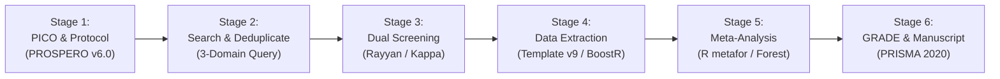

# GP3 Medical Research Engine — Universal Meta-Analysis Pipeline (UMAP)

> **Academic Standards:** Centre for Translational Medicine (CTM / Semmelweis University) · Cochrane Handbook v6.5 · PRISMA 2020 · PROSPERO (NIHR)  
> **Interface:** Pure Conversational AI (No terminal/console required) · Model-Agnostic Architecture (Antigravity, Claude, ChatGPT, Cursor)

---

## 🌟 What is This System?

The **GP3 Medical Research Engine** is an agentic pair-programming and scientific co-pilot system built specifically for academic clinical researchers. It automates and enforces the rigorous, step-by-step development of **systematic reviews and meta-analyses** — from the first clinical idea to PROSPERO registration, literature screening, CTM BoostR data extraction, biostatistical modeling, and publication-ready PRISMA 2020 manuscripts.

### 💬 Pure Chat Interaction — No Terminal Required!
You do **not** need to open a terminal, write shell commands, or run Python scripts manually. You simply talk to the agent here in the chat. The system runs all data scraping, verification scripts, and biostatistical pipelines automatically behind the scenes and reports the findings directly to you in plain academic language.

---

## 🎯 How Quality & Consistency Are Guaranteed Across Any AI

Normally, AI responses vary widely depending on the underlying model (Gemini, Claude, GPT-4o, etc.). **GP3 solves this with a "Code-as-Referee" architecture**: quality is not left to the AI's subjective discretion. It is enforced by deterministic machine gates:

```
┌────────────────────────────────────────────────────────────────────────────────────────┐
│                        THE 4 PILLARS OF MODEL-AGNOSTIC RIGOR                           │
├────────────────────────────────────────────────────────────────────────────────────────┤
│ 1. DETERMINISTIC LINTER GATES (src/validate_protocol.py):                              │
│    Every protocol is audited by an automated 7-gate Python script scoring 0 to 100.    │
│    If an AI (whether Gemini, Claude, or GPT) forgets a required element (e.g.,         │
│    the Suffering Narrative, 1 Safety + 1 Efficacy outcome, or uses 'NOT' in search),   │
│    the script fails with Exit Code 1. The agent is forced to correct it until it       │
│    achieves a passing score (≥70/100).                                                 │
│                                                                                        │
│ 2. FIXED CANONICAL FORM TEMPLATES:                                                     │
│    The AI never invents protocol structures from scratch. It populates standardized,   │
│    pre-validated schemas:                                                              │
│    • PROSPERO Registration: data/wiki/templates/PROSPERO_REGISTRATION_TEMPLATE.md      │
│    • CTM 14-Sheet Extraction: data/wiki/templates/Data_extraction_template_v9.xlsx     │
│    • Canonical PICO Title Formula: "Investigating the effect of [E] on [O] in [P]..."  │
│                                                                                        │
│ 3. GROUNDED WIKI KNOWLEDGE BASE (data/wiki/methodology/):                             │
│    The agent does not rely on its generic pre-trained memory. It directly reads the    │
│    12 official CTM/Cochrane methodology chapters on disk before giving answers.        │
│                                                                                        │
│ 4. REAL-TIME CITATION VERIFICATION (src/citation_verifier.py):                         │
│    Every cited PubMed ID (PMID) is verified live against the NCBI Entrez API to        │
│    guarantee zero artificial hallucinations.                                           │
└────────────────────────────────────────────────────────────────────────────────────────┘
```

---

## 🚀 How to Use It in the Chat: Conversational Playbook

You can conduct an entire meta-analysis by simply guiding the AI through the 6 stages using natural prompts:



### Stage 1: Topic Selection & PICO Formulation
* **What you say:** *"I want to start a new meta-analysis on [e.g., antibiotic stewardship duration on mortality in neonatal sepsis, or PD-1 inhibitors in mismatch-repair proficient colorectal cancer, or SGLT2 inhibitors in heart failure]."*
* **What the AI does:**
  * Invokes `research-sage` to formulate the canonical PICO elements.
  * Formulates the mandatory PICO Title: `"Investigating the effect of [E] on [O] in [P]: A Systematic Review and Meta-Analysis"`.
  * Prespecifies at least **one safety** and **one efficacy** primary outcome.
  * Articulates the 3-part **Suffering Narrative** (Patient morbidities, Family burden, Clinical hope).
  * Scaffolds your project directory in `projects/<project_slug>/`.

### Stage 2: Systematic Search Key Construction & Novelty Audit
* **What you say:** *"Build the search strategy for PubMed, Embase, and CENTRAL, and check if this review already exists on PROSPERO."*
* **What the AI does:**
  * Invokes `lit-reviewer` to mine 5–10 previous meta-analyses in the field for MeSH and free-text keywords.
  * Builds a 3-domain search key (`Domain 1: Population AND Domain 2: Exposure AND Domain 3: Context`) with **zero Boolean 'NOT'**.
  * Executes a live check against PROSPERO and PubMed to ensure the topic is novel.
  * Generates a standalone search strategy ready for PROSPERO PDF upload.

### Stage 3: Operational Feasibility & Poolability Gate
* **What you say:** *"Check the feasibility and poolability of our studies."*
* **What the AI does:**
  * Invokes `feasibility-judge` and `meta-analyzer`.
  * Verifies the **Poolability Rule**: confirms that at least **3 primary studies** report the exact same primary endpoint.
  * Checks the **70% Missing Variable Rule**: prevents meta-regression on variables reported in <70% of literature.
  * Flags any ecological bias risks.

### Stage 4: Dual Screening & CTM BoostR Data Extraction
* **What you say:** *"Help me screen these search results and set up the extraction workbook."*
* **What the AI does:**
  * Facilitates dual independent screening and calculates **Cohen's Kappa ($\kappa$)** inter-rater reliability.
  * Generates your standardized `Extraction_Template_v9.xlsx` workbook (14 sheets).
  * Enforces the **BoostR 5-Point Data Hygiene Checklist** (numeric only, unique Author Year IDs, gap-free tables, standardized outcome naming, and explicit unit conversions).

### Stage 5: Biostatistical Synthesis & Forest Plots
* **What you say:** *"Run the meta-analysis for our primary outcome and create forest plots."*
* **What the AI does:**
  * Invokes `meta-analyzer` to run random-effects inverse-variance or Mantel-Haenszel pooling.
  * Applies **Multilevel Meta-Analysis (Robust Variance Estimation — RVE)** if studies report multiple timepoints or correlated subgroups.
  * Quantifies heterogeneity ($I^2$, $\tau^2$, Cochran's $Q$).
  * Renders publication-quality forest plots and funnel plots.

### Stage 6: Protocol Finalization & Manuscript Writing
* **What you say:** *"Validate my protocol and compile the PROSPERO draft and manuscript."*
* **What the AI does:**
  * Invokes `documentation-writer` to generate [`PROSPERO_DRAFT.md`](file:///c:/Users/shuba/Desktop/Researcher%20-%20D%C3%B3ri/data/wiki/templates/PROSPERO_REGISTRATION_TEMPLATE.md).
  * Automatically runs `src/validate_protocol.py` to ensure a score of $\ge 70/100$.
  * Verifies that the PROSPERO Section 10 status grid has only *"Pilot work"* marked *"Completed"*, while all others are *"Not started"*.
  * Builds GRADE Summary of Findings (SoF) tables and drafts the final PRISMA 2020 manuscript.

---

## 🤖 Meet Your 8 Specialized Research Agents

The workspace features 8 specialized agents, each strictly bound to their scientific domain:

| Agent | Role | Focus |
|---|---|---|
| **`orchestrator`** | Master Conductor | Coordinates the multi-agent pipeline and enforces phase gates. |
| **`research-sage`** | Principal Investigator | Study design, PICO framing, Suffering Narrative, and translational impact. |
| **`lit-reviewer`** | Search Specialist | 3-domain search keys, precedent mining, ⛔ Boolean NOT ban, PROSPERO search. |
| **`feasibility-judge`** | Clinical Logistics | Feasibility testing, 70% missing variable rule, ecological bias prevention. |
| **`meta-analyzer`** | Senior Biostatistician | Poolability rule ($\ge 3$ studies), Confounder Matrix, RoB 2 / QUIPS, RVE modeling, BoostR hygiene. |
| **`mentor-hegyi`** | Translational Mentor | Bedside First, SAP, Avoidable Mortality calculation, 4D Clinical Matrix (1–10). |
| **`mentor-garami`** | Physiological & Methodological Conscience | Biological causality, Sensor-Pathway-Effector triad, measurement integrity, 4D Methodological Matrix (1–10). |
| **`documentation-writer`** | Medical Protocol Scribe | Compiles `PROTOCOL.md`, PROSPERO registrations, Summary of Findings tables, and manuscripts. |

---

## 📁 Standardized Project Architecture

Every research project initiated in `projects/<project_slug>/` follows a clean, predictable structure:

```
projects/<project_slug>/
├── PROJECT.md                           ◄── High-level project state & open mentor questions
├── protocol/
│   ├── PROTOCOL.md                          Full 10-chapter CTM Protocol
│   ├── PROSPERO_DRAFT.md                    Field-by-field copy-paste PROSPERO registration form
│   └── search_strategy.pdf                  Exported search strategy for PROSPERO upload
├── literature/
│   ├── search_queries.json                  Raw queries for PubMed, Embase, CENTRAL
│   ├── search_results.ris                   Deduplicated bibliographic citations
│   └── screening_records.csv                Screening decisions (R1, R2, Cohen's Kappa)
├── data/
│   ├── Extraction_<slug>_Template_v9.xlsx   Official CTM 14-sheet extraction workbook
│   └── study_dossiers/                      Markdown audit dossier for each included study
├── synthesis/
│   ├── meta_analysis.R                      Reproducible R script (metafor)
│   ├── forest_plots/                        Publication-ready TIFF/PNG figures
│   └── grade_sof_table.md                   GRADE Summary of Findings table
├── manuscript/
│   ├── MANUSCRIPT.md                        Publication-ready manuscript draft (PRISMA 2020)
│   └── figures_and_tables/                  Final vector graphics & Word tables
└── scripts/                                 ◄── Project-specific analysis scripts
```

---

## 📚 Canonical Methodology Wiki (`data/wiki/`)

Whenever you or the agent need to check a methodology standard, consult the 12 canonical chapters in [`data/wiki/methodology/INDEX.md`](file:///c:/Users/shuba/Desktop/Researcher%20-%20D%C3%B3ri/data/wiki/methodology/INDEX.md):

* **[01. Translational Medicine Model](file:///c:/Users/shuba/Desktop/Researcher%20-%20D%C3%B3ri/data/wiki/methodology/01_translational_medicine_model.md)**: Healthcare ➔ Science ➔ Knowledge ➔ Communication cycle.
* **[02. Topic Selection & FINER](file:///c:/Users/shuba/Desktop/Researcher%20-%20D%C3%B3ri/data/wiki/methodology/02_topic_selection_finer.md)**: Feasibility, novelty, and the 3-part Suffering Narrative.
* **[03. Clinical Question & Study Design](file:///c:/Users/shuba/Desktop/Researcher%20-%20D%C3%B3ri/data/wiki/methodology/03_clinical_question_frameworks.md)**: PICO, PEO, CoCoPop, PIRD frameworks.
* **[04. Search Strategy & CTM Guide v2.6](file:///c:/Users/shuba/Desktop/Researcher%20-%20D%C3%B3ri/data/wiki/methodology/04_systematic_search_key_guide.md)**: 3-domain queries, precedent analysis, and the Boolean NOT ban.
* **[05. Protocol Design & PROSPERO Guide v6.0/v6.1](file:///c:/Users/shuba/Desktop/Researcher%20-%20D%C3%B3ri/data/wiki/methodology/05_protocol_and_prospero.md)**: Click-by-click CTM registration playbook and [Template](file:///c:/Users/shuba/Desktop/Researcher%20-%20D%C3%B3ri/data/wiki/templates/PROSPERO_REGISTRATION_TEMPLATE.md).
* **[06. Screening & Selection](file:///c:/Users/shuba/Desktop/Researcher%20-%20D%C3%B3ri/data/wiki/methodology/06_screening_and_selection.md)**: Blinded screening, Cohen's Kappa, and CitationChaser.
* **[07. Data Extraction & BoostR Guide](file:///c:/Users/shuba/Desktop/Researcher%20-%20D%C3%B3ri/data/wiki/methodology/07_data_extraction_and_boostr.md)**: CTM Template v9 (14 sheets) and BoostR 5-point data hygiene.
* **[08. Risk of Bias & Pitfalls](file:///c:/Users/shuba/Desktop/Researcher%20-%20D%C3%B3ri/data/wiki/methodology/08_risk_of_bias_and_pitfalls.md)**: RoB 2, QUIPS, ROBINS-I, causal overreach, and ecological bias.
* **[09. Biostatistical Synthesis](file:///c:/Users/shuba/Desktop/Researcher%20-%20D%C3%B3ri/data/wiki/methodology/09_statistical_synthesis_and_heterogeneity.md)**: Poolability rule ($\ge 3$ studies), Multilevel RVE, and TSA.
* **[10. GRADE & Storytelling](file:///c:/Users/shuba/Desktop/Researcher%20-%20D%C3%B3ri/data/wiki/methodology/10_grade_and_storytelling.md)**: CTM 6-sentence storytelling and Summary of Findings tables.
* **[11. CTM 22-Step Master Workflow](file:///c:/Users/shuba/Desktop/Researcher%20-%20D%C3%B3ri/data/wiki/methodology/11_ctm_22_step_master_workflow.md)**: Full Semmelweis CTM Moodle curriculum and SMS milestone gates.
* **[12. Cochrane Handbook v6.5 Reference](file:///c:/Users/shuba/Desktop/Researcher%20-%20D%C3%B3ri/data/wiki/methodology/12_cochrane_handbook_v6_5_reference.md)**: Comprehensive chapter-by-chapter reference guide.

---

## 🛠️ CLI Reference (For Automation & Background Engines)

If you ever want to run automated checks directly, the master CLI is located at [`src/run_pipeline.py`](file:///c:/Users/shuba/Desktop/Researcher%20-%20D%C3%B3ri/src/run_pipeline.py):

```bash
# Check all projects:
python src/run_pipeline.py status

# Scaffold a project:
python src/run_pipeline.py new <slug>

# Validate protocol:
python src/run_pipeline.py validate-protocol <path_to_protocol.md>

# Check phase gate:
python src/run_pipeline.py check-gate --target-phase 2
```

