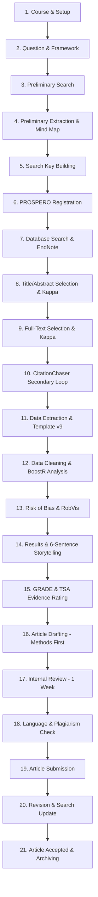

# CTM Systematic Review & Meta-Analysis: 21-Step Master Workflow

> **Source:** Centre for Translational Medicine (CTM / Semmelweis University) E-Learning Guidebook, Meta-Analysis Standard Operating Procedure (SOP), Cochrane Handbook v6.5, and PRISMA 2020.
> **Methodology Governance:** Senior Methodology Supervisor (SMS), Project Statistician, Supervisor (PI), Meta-Analysis Coordinators (*engh.marie@semmelweis.hu*, *amir.makolli@phd.semmelweis.hu*).

---

## 🏛️ Governance, Roles & Communication
Conducting an SRMA within CTM follows strict institutional hierarchy and quality assurance:
- **Senior Methodology Supervisor (SMS):** Oversees methodological integrity. Requires formal sign-off at 8 critical gates before progression (Feasibility, Search Key, PROSPERO, Extraction Sheet, Interim Extraction, Analysis Plan, Draft Review, Submission).
- **Project Statistician:** Advises on data extraction design, verifies statistical feasibility, runs or supervises meta-analytical models (via the BoostR room), and audits forest plots.
- **Supervisor (Lead PI):** Clinical guarantor; provides institutional submission credentials; attends all core milestone meetings.
- **Reviewers (R1 & R2):** Independent duplicate execution across screening, full-text review, data extraction, and Risk of Bias appraisal.
- **Third Reviewer (R3):** Independent adjudicator for disagreements.
- **Shared Infrastructure:** NextCLOUD/OneDrive repository titled with the official project code.

---

## 📋 The 21-Step CTM Lifecycle

---

### Step 1: E-Learning Course & SOP Setup
- Complete the CTM meta-analysis e-learning modules.
- Review the Meta-Analysis Standard Operating Procedure (SOP).
- Set up the project directory in NextCLOUD/OneDrive named strictly with the assigned project code.

---

### Step 2: Question Development & Framework
- Frame the clinical problem using the appropriate structural architecture:
  - **PICO:** Population, Intervention, Control, Outcome (interventional studies).
  - **PE(C)O:** Population, Exposure, Comparator, Outcome (prognostic/etiology cohorts).
  - **CoCoPop:** Condition, Context, Population (prevalence/incidence).
  - **PIRD:** Population, Index test, Reference standard, Diagnosis (diagnostic test accuracy).
- **Guidelines Check:** Search for and upload all relevant international clinical guidelines to the cloud folder.
- **Working Title:** Formulate the PICO title: *"Investigating the effect of [Exposure/Intervention] on [Outcome] in [Population]"*.

---

### Step 3: Preliminary Searches & Feasibility Check
- Search PubMed and Embase for existing evidence:
  - **Keyword Harvesting:** Identify 5–10 previous meta-analyses per domain and analyze their search strings to harvest proven MeSH terms, Emtree terms, and free-text synonyms.
  - **Identify Key Articles:** Find 3–4 original research articles that directly answer the proposed PICO question with complete numerical outcome data.
  - **Previous Meta-Analyses Assessment:**
    - *If previous MA was inconclusive and >2–3 years old:* Update is justified.
    - *If previous MA was conclusive:* Must define a genuine new angle (new subgroup, meta-regression, dose-response, or newly published trials).
    - *If previous MA was very recent:* Cannot be repeated unless a fundamentally novel angle exists.

---

### Step 4: Preliminary Data Extraction & Mind Map
- Prepare a **Clinical Mind Map** to help project statisticians grasp the pathophysiology, clinical pathway, and exposure-outcome dynamics.
- Conduct a preliminary data extraction on the 3–4 key articles.
- **Milestone Meetings:**
  - *Preliminary Data Extraction Meeting 1:* SMS, supervisor, and statistician set up the preliminary extraction sheet.
  - *Preliminary Data Extraction Meeting 2:* Review findings and formally confirm statistical feasibility before moving to protocol registration.

---

### Step 5: Search Key Construction & Feasibility Testing
- Construct 3-domain search keys (`1. Population AND 2. Exposure/Intervention AND 3. Therapy/Context`).
- **Forbidden Operator:** Never use the Boolean `NOT` in search strings (prevents inadvertent exclusion of multi-topic landmark papers).
- **Feasibility Testing:** Verify that all 3–4 identified key articles are successfully retrieved by the final search key.
- **Documentation:** Export an itemized PDF listing the exact syntax, interface settings, limits, and hit counts for each database.
- **Sign-off:** Obtain formal SMS approval before running the final search.

---

### Step 6: Protocol Pre-Registration (PROSPERO)
- Pre-registration is mandatory **BEFORE** screening begins.
- Draft the protocol using the CTM PROSPERO guide and Statistical Part Template.
- Account credentials must be shared with the SMS.
- ⚠️ **STRICT EMBARGO:** DO NOT submit the PROSPERO protocol directly. Only an SMS-approved protocol may be submitted. Record and track the PROSPERO registration ID (e.g., CRD4202XXXXX).

---

### Step 7: Systematic Database Search & EndNote File Management
- Execute the search across the mandatory core databases: **MEDLINE (PubMed)**, **Embase**, and **Cochrane CENTRAL**.
- Download raw bibliographic files:
  - PubMed: `.nbib`
  - Cochrane CENTRAL: `.ris`
  - Embase: `.ris`
- **Standardized File Naming Convention:**  
  `Database name_number of files_date of search_initials`  
  *Example:* `Pubmed_6700_08.11.2025_AM`, `Embase_1561_08.11.2025_AM`, `CENTRAL_23_08.11.2025_AM`.
- Import all references into EndNote, execute systematic deduplication, and export the deduplicated pool for screening.

---

### Step 8: Title & Abstract Selection (Rayyan)
- Import deduplicated records into Rayyan.
- **Pilot Selection:** R1, R2, SMS, and supervisor jointly screen ~100 records to calibrate eligibility criteria and draft a written **Selection Protocol**.
- **Independent Duplicate Screening:** R1 and R2 screen all records blindly in duplicate.
- **Interrater Agreement (Cohen's Kappa):**
  - Calculate Cohen's $\kappa$ using the standard 2x2 agreement matrix (Both Include, Both Exclude, R1 Only, R2 Only).
  - Categorization:
    - `0.01 – 0.20`: Slight agreement
    - `0.21 – 0.40`: Fair agreement
    - `0.41 – 0.60`: Moderate agreement
    - `0.61 – 0.80`: Substantial agreement
    - `0.81 – 1.00`: Almost perfect / Perfect agreement
  - Complete and submit the **Cohen's Kappa Documentation Form** to the SMS.
- **Disagreement Resolution:** Adjudicated by third reviewer (R3) or consensus.
- Populate initial boxes of the PRISMA 2020 Flowchart.

---

### Step 9: Full-Text Selection
- Retrieve full-text PDFs using EndNote ("find full-texts" on university VPN) and manual library retrieval.
- **File Naming Convention:** `Author Year (+ distinguishing feature if needed)`.
- Share the full-text PDF repository in the project Drive.
- **Reason for Exclusion:** Systematically record the exact reason for exclusion for every excluded article (mandatory for PRISMA flowchart).
- **Systematic Review vs. Meta-Analysis Distinction:** If an article meets PICO inclusion criteria but lacks extractable numerical data for meta-analysis, it **MUST NOT be excluded**—it is retained and synthesized in the systematic review narrative!
- Independent duplicate screening by R1 and R2; calculate full-text Cohen's $\kappa$; resolve discrepancies with R3.

---

### Step 10: Reference Checking & CitationChaser Phase
- To guarantee comprehensive evidence retrieval, conduct backward and forward citation chasing on all included full-text articles using **CitationChaser**.
- Export references and citing papers.
- **Deduplication:** Remove articles already screened during Steps 7–9 using the CTM subtraction protocol.
- Screen remaining CitationChaser hits in Rayyan in duplicate (Title/Abstract and Full-Text).
- **File Naming:**  
  `CitationChaser_TA selection_date_initials`  
  `CitationChaser_Fulltext selection_date_initials`
- Add newly identified eligible studies into the final pool for data extraction.

---

### Step 11: Data Extraction & Template v9 Adaptation
- Use the official **`Data_extraction_template_v9.xlsx`** (14 standardized sheets):
  - `Basic layout`: Study characteristics, design, country, centers, demography.
  - `ORs - RRs`: Dichotomous outcomes (crude 2x2 counts and precalculated adjusted aOR/aRR).
  - `Mean Difference`: Continuous outcomes across two groups (mean, SD, median, IQR).
  - `Simple mean`: Single-arm continuous outcomes.
  - `Ratio`: Single-arm proportions and prevalence.
  - `Before-After`: Paired continuous pre/post interventions.
  - `Diagnostic test`: TP, FP, TN, FN, sensitivity, specificity, AUC.
  - `Correlations`: r, sample size, type.
  - `Regression coefficient`: Beta, SE, CI, and adjusted covariates.
  - `RoB2`, `QUIPS`, `Joanna-Briggs`, `QUADAS`, `ROBINS`: Risk of bias domain assessments.
- **Adaptation Rules:**
  - Insert columns for all pre-specified clinical confounders into study/population characteristics.
  - Duplicate outcome columns for each additional outcome.
  - Optionally insert RoB domain columns beside outcomes to evaluate RoB simultaneously.
- **Extraction Milestone Meetings:**
  1. *Extraction Sheet Development Meeting:* SMS, supervisor, statistician, R1, and R2 approve the adapted Excel sheet.
  2. *Pilot Extraction:* R1 and R2 extract 3–4 articles independently and compare notes.
  3. *Interim Meeting (Mandatory):* Held after **20–30%** of data extraction is complete (with SMS, supervisor, statistician) to catch systematic errors early.
  4. *Completion Meeting:* Reconcile parallel extraction sheets, resolve discrepancies, and formally hand over data to the statistician.

---

### Step 12: Data Cleaning & BoostR Room Analysis
- Meeting with statistician, SMS, and supervisor to decide if analysis is conducted by the researcher in the **BoostR Room** (under supervision) or by the statistician.
- **Strict Data Cleaning Checklist for Analysis:**
  1. **Numeric only:** Numerical fields must contain strictly numbers (no text, notes, ranges, or symbols).
  2. **Study identifiers:** Every row must include `Author Year` and a unique study ID.
  3. **No empty rows or cells:** Prevent table breaks in R and Excel.
  4. **Identical outcome names:** Outcome labels across studies pooled in the same forest plot must have 100% identical strings (e.g., `Outcome 3 weeks`).
  5. **Unit Standardization:** Convert all values to a single standard unit (SI or European standard). **Always perform conversions in a copied column** to preserve raw data and trace errors.

---

### Step 13: Risk of Bias Assessment & RobVis
- Select the validated design-specific appraisal instrument:
  - **RCTs:** Cochrane **RoB 2**
  - **Prognostic / Etiology Observational Studies:** **QUIPS**
  - **Non-Randomized Interventional Studies:** **ROBINS-I**
  - **Diagnostic Accuracy:** **QUADAS-2**
  - **Prevalence / Incidence:** **JBI Critical Appraisal Tools**
- Independent duplicate evaluation by R1 and R2; consensus or R3 resolution.
- Generate visual summary traffic-light and weighted bar plots using **RobVis**.

---

### Step 14: Results & 6-Sentence Storytelling
- Results meeting with statistician, SMS, and supervisor to interpret forest plots, explore heterogeneity ($I^2, \tau^2$), and evaluate potential post-hoc sensitivity analyses.
- **The 3x5 Forest Plot Rule:** Follow the structured 3x5 rule when presenting forest plots at CTM group meetings.
- **The 6-Sentence, 1-Minute Storytelling Framework:**
  Before writing narrative sections, synthesize the entire study into 6 concise sentences:
  1. **Problem to solve:** (The clinical burden)
  2. **Unmet need:** (The exact knowledge gap)
  3. **Conclusion based on main findings:** (What the pooled evidence proved)
  4. **Implication for practice:** (What clinicians should do tomorrow)
  5. **Implication for research:** (What trials are needed next)
  6. **Implication for policymakers:** (What guidelines or funding must change)
- ⚠️ **NARRATIVE EMBARGO:** Do NOT write the story parts of your paper (Introduction, Discussion, Conclusion) until the results and story have been successfully presented and approved at a CTM group meeting!

---

### Step 15: GRADE & Trial Sequential Analysis (TSA)
- Assess evidence certainty using **GRADEpro** (pairwise) or **CINeMA** (network meta-analysis).
- Evaluate the 5 downgrade domains (Risk of bias, Inconsistency, Indirectness, Imprecision, Publication bias) and 3 upgrade domains (Large effect, Dose-response, Confounders reduce effect).
- Use **TSA (Trial Sequential Analysis)** to determine optimal information size (OIS) and adjust for repetitive testing.
- Produce a formal **Summary of Findings (SoF) Table**.

---

### Step 16: Article Drafting (PRISMA Standards)
- **Drafting Sequence:** `Methods → Results → Conclusion → Discussion → Introduction`.
- **Word & Figure Limits:**
  - Manuscript text: $\le 3,000$ words (excluding abstract, references, tables/figures).
  - Tables & Figures: $\le 5–7$ combined.
  - Abstract: $250–300$ words (structured strictly according to PRISMA 2020 for Abstracts).
- **Reporting Protocol Deviations:**
  - *Major / Topic-related deviations* (e.g., regrouping of subgroups, post-hoc exclusions): Explicitly declare as a **"board decision"** from group meetings and state the rational scientific justification.
  - *Minor procedural deviations* (e.g., disagreement resolution method): Transparently report directly with rationale.
- **Figure Proofing:** Check all generated vector figures for special character encoding issues (e.g., verify that $\tau^2$ has not been corrupted into `?-squared`).
- Fill in the PRISMA 2020 checklist with exact manuscript page numbers for supplementary submission.

---

### Step 17: Internal Review & Adjudication
- Compile complete manuscript with figures, legends, and supplementary materials into the project Drive.
- SMS sends formal notification to all co-authors with a strict **one-week deadline** for feedback.
- Hold an internal review meeting with SMS and supervisor to adjudicate comments and decide which suggestions to incorporate.

---

### Step 18: Language Editing & Plagiarism Check
- SMS submits the revised manuscript to institutional language editing.
- Authors manually review and accept language edits (except any that alter scientific meaning).
- Perform mandatory authenticity and plagiarism verification (e.g., Turnitin / iThenticate).

---

### Step 19: Article Submission
- Select target journal conforming to CTM Journal Selection Policy.
- Submission must be executed from an account under the **supervisor's name and email address**.
- Archive submission files in a dedicated Drive folder: `date of submission_journal name`.
- **Search Update Rule at Submission:** A search update should only be performed if the search is older than 12 months AND the update can be completed in $\le 1$ day.

---

### Step 20: Article Revision & Search Update Protocol
- Upon receiving reviewer comments, immediately notify the SMS and schedule a project revision meeting (supervisor mandatory; statistician required if re-analysis is requested).
- **Co-Author Accountability Rule:** If co-authors fail or refuse to assist with revision work in a timely manner, they are removed from co-authorship to the Acknowledgements section (formal PI notification required) and replaced by PhD/TDK peers.
- **Search Update Protocol (if requested during revision):**
  1. Re-run identical search queries across all databases with original settings.
  2. Use the Cohen's Kappa / Search Diff tool to isolate newly published records (disagreements between old pool and new pool).
  3. Import new records into EndNote, deduplicate, and screen in duplicate.
  4. Update the PRISMA flowchart:  
     $$\text{Total Search} = \text{New Search Total}$$  
     $$\text{Duplicates Removed} = \text{Old Duplicates} + \text{New Duplicates}$$  
     $$\text{Records Screened} = \text{Total Search} - \text{Duplicates Removed}$$  
     $$\text{Full-Texts Screened} = \text{Old Full-Texts} + \text{New Full-Texts}$$

---

### Step 21: Article Accepted & Archiving
- Upload accepted manuscript details, final published PDF, and complete clean extraction workbook to the CTM Moodle platform.
- Archive the final NextCLOUD project folder.