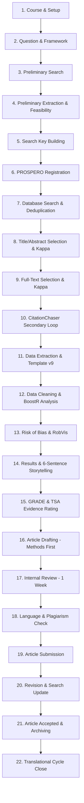

# 11. A CTM 22-Lépéses Mester Munkafolyamat & Moodle Kurrikulum

> **GP3 Methodology Wiki Layer** · Centre for Translational Medicine (CTM / Semmelweis Egyetem)  
> **Központi Index:** [Vissza a Módszertani Tartalomjegyzékhez](file:///c:/Users/shuba/Desktop/Researcher%20-%20D%C3%B3ri/data/wiki/methodology/INDEX.md) | [Főportál](file:///c:/Users/shuba/Desktop/Researcher%20-%20D%C3%B3ri/data/wiki/README.md)  
> **Eredeti CTM Források:** `TM/Main-steps-of-the-workflow.MD` és `TM/Guidebook _ TM-centre E-learning.pdf` (45 oldal, hivatalos Moodle kurrikulum)

---

## 🏛️ Governance, Szerepkörök & Kommunikáció
A CTM szisztematikus áttekintések és metaanalízisek szigorú intézményi minőségbiztosítási hierarchiát követnek:
- **Senior Methodology Supervisor (SMS):** Felügyeli a módszertani integritást. **8 kritikus kapunál kötelező a formális SMS jóváhagyás:**
  1. Feasibility (Megvalósíthatóság),
  2. Search Key (Keresőkulcs),
  3. PROSPERO Regisztráció,
  4. Extraction Sheet (Adatkinyerési táblázat),
  5. Interim Extraction (Félidei adatkinyerés ellenőrzése),
  6. Analysis Plan (Elemzési terv / BoostR),
  7. Draft Review (Kézirat belső bírálata),
  8. Submission (Folyóirat benyújtás).
- **Projekt Biostatisztikus:** Tervezi az adatkinyerési architektúrát, ellenőrzi a statisztikai megvalósíthatóságot, futtatja vagy felügyeli a BoostR modelleket, auditálja a forest plotokat.
- **Témavezető (Lead PI):** Klinikai kezes; biztosítja az intézményi benyújtási hátteret; részt vesz a kulcsfontosságú megbeszéléseken.
- **Recenzensek (R1 & R2):** Független kettős végrehajtás a szűrésben, teljes szövegű válogatásban, adatkinyerésben és torzításkockázat értékelésben.
- **Harmadik Recenzens (R3):** Független döntőbíró nézeteltérések esetén.

---

## 📋 A Teljes Munkafolyamat Életciklusa

---

## Modul 01: Bevezetés és a Metaanalízis Munkafolyamat

### Introduction

Welcome to your meta-analysis workflow. This section of moodle will be used to introduce you to the steps of meta-
analysis, one by one, and at the same time it will keep track of your progress on your own project and make sure the
Coordinators have access to the most important, key files.
Once you complete key sections, new group meeting templates will become available to you - always use the most
recent one in the workflow during your group meetings!
Of course, this guidebook can only scratch the surface. The very first step is to complete the meta-analysis e-learning
course. For the technical/management part and elaboration on responsibilities, please check the Meta-analysis SOP in
detail, and return back to it every time you become unsure. For detailed methodological guidance, you can always
consult the Cochrane Handbook and ask your SMS. If the question is too difficult for your SMS, they will discuss it at
the SMS meeting and in truly complicated situations, the SMS's will reach out to the meta-analysis coordinator
(engh.marie@semmelweis.hu) and the deputy meta-analysis coordinator (amir.makolli@phd.semmelweis.hu).
Resources
Cochrane handbook
This handbook is the "bible" of meta-analysis. Generally, we should follow their guidance on any question.
Project books of previous years
These are the project books of previous years, containing examples of projects.
Meta-analysis SOP
This is the Standard Operating Procedure for Meta-Analysis, and contains detailed guidance for what is necessary at
each step, and who is responsible for what. Please keep it at hand and check back to it for each step once you reach
it!
NextCLOUD link
This is the CLOUD link where you can access your folder.

---

## Modul 02: A Kezdetek (Mi a Szisztematikus Áttekintés és Metaanalízis?)

### The Beginning

Welcome to the beginning of your first meta-analysis!
A systematic review and meta-analysis is a way to (as the name might tell you) systematically review the previously
published literature, and mathematically meta-analyze them - this means to calculate a summary overall from all
published previous results. This gives an answer to the question with a larger sample size, allows us to establish
hypotheses for influencing factors, and - if done with high quality data - allows us to answer the question with the
highest level of evidence.
The first important step when developing your own question is to understand how questions may be framed in the
context of a meta-analysis. There are different examples of question frameworks, which will be discussed on the meta-
analysis course practice. The practice in this section is meant to give you practical examples of different question
types.
Question Frameworks:
- PICO: Most well known. Stands for "Population, Intervention, Control, Outcome" and is applicable to interventional
reviews/meta-analyses
- PE(C)O: Stands for "Population, Exposure, Comparator, Outcome" and applies to reviews which are not interventional
but have a direct comparison
- CoCoPop: For meta-analyses investigating rates (Condition, Context, Population)
- PIRD: Diagnostic test meta-analyses. Population, Index test, Reference, Diagnosis (the diagnostic test outcome
parameters are implied)
Please complete the practice in this section on how to extract the question from an article. We have given you 8 articles to
extract the question framework from, and there are two example articles for each possible question framework.

Resource: Initial group meeting template
Practice: Recognizing the PICO
Please look at the attached journal articles, and try to extract their PICO into the attached Excel sheet.

---

## Modul 03: Kérdésfeltevés és Témameghatározás (Question Development)

### Question Development

Now it's time to develop your own topic. Based on what you've already learned about types of meta-analyses and
question frameworks, think of the question you would like to answer in your research, and try to fit it into one of the
frameworks. Then, complete the tasks below, so your SMS can check your intended question framework.
One task here is to create a  working title  for your project. Don't overthink it - the final title will be related to
your results anyway!

Tasks:
Guidelines checked
Please check the current guidelines related to your topic and upload them to the drive folder belonging to your
project.
Research question
Please upload here your research question, and make sure to update it if it changes.

---

## Modul 04: Előzetes Irodalomkutatás és Keresőkulcs Alapok

### Preliminary searches

During the development of your question, it is important to check the literature for existing articles.
How do we search?
On PubMed or Embase
Filtering for recent years and/or study types
What are we looking for?
Key articles: these are original research articles that answer the same question you are asking, or contain the
data that you need to answer it. They can help you decide which approach you should take or how your exact
question should be phrased, and finding enough (4) that answer your question can prove that this is a potentially
feasible topic for a meta-analysis.
Current areas of research interest: What are the publications on the question in the past 2-3 years? Where are
the hot areas of research focus that everyone is investigating now? These are more likely to be published!
Previous meta-analyses: If you find previous meta-analyses, there are two potential roads:
If the previous meta-analysis was not conclusive, and it has been a few years, we might update the meta-
analysis. Search for original research articles on the question that have been published since and were not
originally included.
If the previous meta-analysis was conclusive, the question is answered and there is no reason to update it -
unless you can find a new angle. Maybe a new subgroup analysis, or an investigation of influencing factors
by meta-regression or dose-response analysis.
If the previous meta-analysis was very recent, there is no reason to repeat it as there likely is not a lot of new
data - unless you have a new angle of course.
Designing your preliminary search key:
1.) Start with deciding on the domains you will need. Start with two domains, usually this will be the population
and the intervention or exposure.
2.) Once you have decided on the domains, find 5-10 meta-analyses for each domain (e.g: for domains of obesity
and diabetes, find 5-10 meta-analyses about obesity and 5-10 meta-analyses about diabetes).
3.) Look at their search keys: Look at how they phrased their domains. They may not be perfect, but can give you
great inspiration for key words to include.

Resources
Search Key Guide

This is the search key guide for building a final search key. Keep in mind that preliminary search keys do not
necessarily follow the same rules as final ones, because they do not need to catch all articles - they can be a little more
specific. The final search will be much more broad, because it will be followed by a systematic selection.
PubMed
The most common and freely accessible database for searching
Embase
Another important database
CENTRAL
The Cochrane Library, useful for finding clinical trials and clinical trial protocols

---

## Modul 05: Előzetes Adatkinyerés és Megvalósíthatósági Kapuk (Feasibility Testing)

### Preliminary Data Extraction

In this section, we will test the feasibility of your project. For this, you should find 3 key articles that fit your PICO. Next,
you will meet with the statisticians to decide which parameters will be useful, you will perform a preliminary data
extraction and adapt the preliminary data extraction sheet. Before the meeting, please upload the key articles to your
cloud, which your SMS will check for appropriateness. Make sure you are familiar with the data extraction template
and how to use it before the meeting! Once the meeting is set up for use, you will extract data, which the statisticians
will check for feasibility.
Preliminary data extraction sheet tutorial:

Also search for any previous meta-analysis, and upload relevant guidelines here, to ensure that your topic is novel. If
there are previous meta-analyses, please upload them below.
Resources
Preliminary data extraction template
Drive folder structure
Please add this folder to your OneDrive, and share it with your SMS and supervisor (and later the project statistician).
Change the title to your project code (if you're not sure, ask your SMS).
Mind Map
This mind map will help the statisticians understand the clinical question, please prepare it for the meeting.
Tasks:
Key articles highlighted and uploaded
Highlight all your found key articles (PICO elements with particular emphasis on outcome data) and upload them to
the drive, then check this checkmark.
Preliminary data extraction meeting 1

A meeting should be held with your SMS, supervisor and the statistician to set up the preliminary data extraction
sheet. Check this off once you've held the meeting.
Preliminary data extraction meeting 2
After completing the preliminary data extraction, a second meeting should be held with the same participants to
discuss the findings, after which data should be handed over to the statistician. Check this once completed.

---

## Modul 06: Végleges Keresőkulcs Építés és Szakértői Precedensek

### Search key

Congratulations on your feasible topic! It's time to build your final  search key, which you will use to conduct your
systematic search. For this, we have attached some example search keys and their topics, please also watch the
instruction video. Then, complete the task below with your intended search key, your SMS will check whether it is
acceptable.
Once your search key has been deemed acceptable, move on to the next task and check whether it actually found all
your key articles.

#### 📌 Resources:

Search Key Guide
Group meeting template with progress
Tasks:
Search key finalized
Check this off if your search key is finalized and has been tested for feasibility. (i.e.: All your key articles were found with the
search key, the numbers are feasible when compared to the number of investigators available).
Final search key
Please upload your final search key in PDF format (use the template), itemized per database. Make note of the
settings on the individual databases and the number of results for each database.
If your search key changes, please update this document!

---

## Modul 07: PROSPERO Protokoll Regisztráció

### Protocol registration

Registering your  PROSPERO  protocol at this stage is mandatory. Please create an account on  PROSPERO  with a
password you do not mind sharing, then share the login details with your SMS.
Next, complete your protocol (refer to the attached examples and the guide for help). Do take care to read the guide
in detail before starting, it contains all the information that you need. Use the statistical part template to draft the
statistical part - if the project is complex and not covered by the template, then consult the statisticians. DO NOT
SUBMIT IT. Once you have completed your draft, your SMS will check it to either approve or reject it.
Only the approved PROSPERO protocol may be submitted.

Resources
Prospero
PROSPERO guide
Statistical part template
Group meeting template with progress
This template can be used once the feasibility check is passed.
Tasks
Prospero started
Check this off if you have started drafting your PROSPERO registration. Make sure to follow all guides!
Prospero submitted
Check this checkmark once you've submitted your PROSPERO (after approval by your SMS!).
PROSPERO identifier
Upload the identifier of the submitted PROSPERO registration.

---

## Modul 08: Szisztematikus Adatbázis Keresés és Fájlkezelés

### Database search

You've arrived at the step of the systematic search.
When doing your search, make note of all settings, the date and the exact search key used in each database, and
upload it below.
Once you have performed your systematic search (rely on your SMS and the tutorials for help!), upload the search files
to your drive folder. Then, import them to EndNote and remove duplicates - again, the tutorials, the Meta-Analysis
SOP and your SMS can help with anything that is not clear.
Database export tutorial

#### 📌 Resources:

Group meeting template after search

#### 📌 Assignments:

Tasks:
Search details
Upload a PDF containing the exact search key and date, the number of results per database and the settings for
each.
Update the Search Files from databases
After doing the database search and downloading all the articles, upload them here as well.
Make sure to name the files appropriately, so Database name_number of files_date of search_your initials.
For example: Pubmed_6700_08.11.2025_AM
Search files added to Drive
Upload your search files to your drive folder (named after the database and the date of search!), then check this
checkmark.
Duplicates removed
Check this off once all duplicates have been removed.

---

## Modul 09: Cím és Absztrakt Szűrés (Rayyan Kettős Független Szelekció)

### Title & Abstract selection

Title and abstract selection is performed in duplicate, by two independent investigators, after a meeting at which a
pilot selection is performed and the exact selection criteria are laid out. At the CTM, we currently use Rayyan for the
selection, you can find a link below.
During the pilot selection, please sit with your co-investigator, SMS and supervisor and discuss around 100 of the
records to check that any questions are resolved and all selection criteria are clear. Write a selection protocol! You
can use the attached template. Expand parts on the basis of things that are not clear during the pilot selection. Keep
in mind that we calculate the Interrater Agreement/Cohen's kappa to prove that our selection criteria were
prospectively decided and reproducible - so it is important you make a clear selection protocol and follow it
exactly!
After agreeing on the protocol and doing a pilot selection,   do your selection separately - once it is complete, the
interrater agreement will be calculated.
The interrater agreement is assessed using the cohen's kappa, which calculates the degree to which the two
independent selections overlapped. For this, you need to know: The number of records both investigators (or
investigator teams) wanted to include, the number of records both wanted to exclude, the number of records only
Team 1 wanted to include and the number of records only Team 2 wanted to include. To learn how to extract the
numbers for the calculation and how to proceed further, please watch the video tutorial!
Those titles that you do not agree on should be reselected by a third reviewer (or, more rarely, resolved by discussion).
At this stage, you can start filling in the PRISMA flowchart using the uploaded template and guide.

### Creating a project in Rayyan Tutorial

What to do after selection Tutorial

More guides and tutorials for Rayyan may be found here!
Cohen's kappa calculator
Enter here the numbers you agree to include ("Both include"), the number of records you agree to exclude ("both
exclude"), the records only you want to include "First include, second exclude" and the records only your co-
investigator wanted to include ("Second include, first exclude").
This is what the different designations mean:
0.01 – 0.20 slight agreement
0.21 – 0.40 fair agreement
0.41 – 0.60 moderate agreement
0.61 – 0.80 substantial agreement
0.81 – 1.00 almost perfect or perfect agreement

Enrolment options
This course is intended to guide yo
how to carry out a systematic revie
meta-analysis.

Guest access
Password
SUBMIT
•



Resources
Rayyan
Invite to your project the following people:
- Your SMS
- Anyone who will perform selection with you (Co-Investigator, TDK student)
- Meta Coordinators (marieaengh@gmail.com)
Group meeting template after Title and Abstract selection
Selection protocol template
Adapt this template to create your own selection protocol that helps keep your selection systematic.
Cohen's Kappa Documentation
Fill out this form when you calculate the Cohen's Kappa, and send it to your SMS for approval
PRISMA checklist materials
Tasks:
Upload completed Title & Abstract Selection
After the title and abstract selection process is finished by both you and your pair, update here the full title & abstract
selection results.
How to do so: When everything is done, go the "All articles" tab, and export all the articles (including article
information, abstracts, labels, decisions and everything. Check all the checkmarks there).
Upload that file here.
Pilot title-abstract selection completed

Pilot your title-abstract selection by testing it together on 100 titles, discovering and elaborating on any selection criteria that
are unclear, then check this checkmark off.
Own title-abstract selection completed
Check this off once you've completed your own title-abstract selection!
Co-investigator title-abstract selection completed
Check this checkmark once your selection pair (co-investigator) have completed their selection.
Title-abstract disagreements resolved
The titles that you and your selection pair(s) do not agree on should be resolved. This is usually done by a third investigator,
but may also be done by discussion. Once these are resolved, please check this off.

---

## Modul 10: Teljes Szövegű Szelekció (Full-Text) és Cohen's Kappa

### Full text selection

The process for full-text selection starts with finding all the full-texts that should be checked, and uploading them to
your drive. A tutorial for this may be found below.

> 💡 **Important:**

EndNote "find full-texts" works best if on the university network, or VPN. TIP: After searching with EndNote,
open up the associated .data folder. Open the "PDF" folder, then use the search function to search for *.pdf. You
can then highlight all the pdf files, and move them to a separate folder in which you add the manually found
papers. Don't bother attaching them all to the relevant record - name them "Author Year (+ distinguishing
feature if necessary)" and share the whole folder with your collaborators.
The process for searching for unfound full-texts is described in the SOP and will need to be reported in the
paper.
Unfound full-texts may be conference abstracts. In this case, the abstract constitutes the full text.
It isn't necessary to upload the full-texts to rayyan if performing the selection there - it constitutes a lot of manual
labor. Alternatively, name files "Author Year" and share them in a drive folder with your co-selectors.
For large projects, it may be easier to perform the selection in EndNote. Share the drive folder and a library with
your collaborators, use the calculator below for the Cohen's kappa.
Then, it is similar to that of title-abstract selection, except you now have the full information and will be able to make
final decisions.
At this stage, you must make note of the reason for exclusion for each record. Also keep in mind that, if the article
fits your selection criteria but would not be eligible for meta-analytical calculations, this is not a reason for exclusion!
These articles should be kept, and included in the systematic review part of your study.

#### 📌 Tutorials:

How to find full-texts using EndNote
Cohen's kappa calculator

Enter here the numbers you agree to include ("Both include"), the number of records you agree to exclude ("both
exclude"), the records only you want to include "First include, second exclude" and the records only your co-
investigator wanted to include ("Second include, first exclude").

### Cohen's Kappa calculator

Both include:
0
Both exclude:
0
First include, second exclude:
0
Second include, first exclude:
0
Calculate
Cohen's kappa calculator for EndNote
Upload here your two separate selection files from EndNote (if selection was performed there). You will receive a
downloadable file of agreements and disagreements..

ORIGINAL
Reviewer A
Reviewer B
•


#### 📌 Resources:

PROSPERO
Cohen's kappa calculator (Rayyan compatible)
Cohen's Kappa Documentation
Fill out this form when you calculate the Cohen's Kappa, and send it to your SMS for approval
Tasks:
Full texts loaded to drive
The full-texts for selection should be loaded into the drive folder to make them accessible to everyone involved in the
project. Once you've found them and loaded all, mark this step as completed.
Full-texts
Upload the link to the drive folder containing the eligible full-texts.
Upload completed Full text Selection
After the full text selection process is finished by both you and your pair, update here the whole full text selection
results.
How to do so: When everything is done, go the "All articles" tab, and export all the articles (including article
information, abstracts, labels, decisions and everything. Check all the checkmarks there).
Upload that file here.
Own full text selection completed
Mark this as completed when you have completed your version of the selection.
Co-investigator full text selection completed
When your selection pair has completed their version of the selection, mark this as completed.
Full text disagreements resolved

Mark this as completed once the disagreements have been resolved.

---

## Modul 11: Irodalomjegyzék Ellenőrzés és CitationChaser Fázis

### Reference checking/citation chaser phase

The references of your included studies should be systematically checked for eligible articles.
Use the tool below to find all references of your eligible full-texts. Then you will perform a systematic selection
identical to the previous steps on the found articles.
Finally, combine the eligible articles from both steps into one folder, ready for data extraction.
Tutorial: Citation chaser

Tutorial 2: How to remove previously screened articles in the reference and citation chaser step?
Citation chaser - tutorial 2
Cohen's Kappa Calculator (use this one for the process described in tutorial 2):
•




#### 📌 Resources:

CitationChaser
Tasks:
Upload the Reference/Citation Chaser files
After downloading the files from the Reference/Citation Chaser tool, upload them here as well.
Make sure to name the files appropriately, so References_date_initials and Citations_date_initials
For example: References_08.11.2025_AM and Citations_08.11.2025_AM
Upload completed Title & Abstract and Full text Selections
After the title and abstract selection and full text processes of references/citation chaser articles are finished by both
you and your pair, update here the full results.
How to do so: When everything is done, go the "All articles" tab, and export all the articles (including article
information, abstracts, labels, decisions and everything. Check all the checkmarks there).
Name them appropriately: CitationChaser_TA selection_date_initials and CitationChaser_Fulltext
selection_date_initials
For example: CitationChaser_TA selection_08.11.2025_AM and CitationChaser_Fulltext selection_08.11.2025_AM
Citation chaser search performed
Search using the citation chaser, perform a selection of the found hits and once all included papers have been uploaded to
your drive, mark this as completed.

---

## Modul 12: Adatkinyerés és Validáció (CTM Template v9)

### Data extraction and validation

In this step, you will create your data collection table.
In the first task of this section, you will find a data extraction template. This still needs to be adapted to your specific
topic. It contains examples for how each type of outcome should be extracted. To adapt it to your topic please:
1. Add new columns for all clinically relevant confounding factors you think should be described in the study
characteristics table or taken into account for analysis. Add these columns to the relevant sections (Demographic
data/Intervention/Comparator).
2. Copy outcome columns in the way that fits your topic and delete columns that are not relevant to your topic (for
example, if you are not assessing diagnostic test accuracy, these columns can be deleted. Similarly, if you have
more than one dichotomous outcome, you will need to duplicate these columns). Add relevant columns as
needed that describe each outcome.
3. Advanced: Adding columns for the domains of the risk of bias tool you will use may save you time later, as you
only need to go through the papers once. They should be added after each outcome, as RoB assessment is done
per outcome.
You can draft the data extraction with the help of your SMS, however the data extraction meeting is mandatory before
data extraction can commence. Attendees are you, your SMS, your supervisor, the statistician and your co-investigator
who will help with data extraction.
Do a preliminary data extraction of 3-4 articles with your co-investigator, then meet with her or him to compare notes
and see if you agreed on everything.
After the first 20-30% of data extraction is done, the interim meeting should be held, again with you, your SMS, your
supervisor, the statistician and your co-investigator.
NB: Keep your data extraction table in your Drive folder during the extraction! This will allow your SMS to supervise
your progress and help catch any errors as they occur. Highlight your articles in the drive.
Tutorial: Data extraction template

#### 📌 Resources:

Data extraction template
Use this meeting to draft your data extraction template, then present and adjust it at the data extraction meeting.
Tasks:
Extraction sheet development meeting
Mark this as completed after you've held the meeting to develop the data extraction sheet. (Participants: SMS,
supervisor, statistician, co-investigator, YOU!)
You can prepare for this meeting by drafting the data extraction sheet, using the provided template.
Interim meeting held
This meeting should be held after 20-30% of your data extraction is completed, with SMS, supervisor and statistician
present. This is to make sure the data extraction is proceeding as planned and no errors are going undetected. Mark
this as completed once the meeting has been held.
Primary data extraction completed
Check this off once you've completed your version of the data extraction.
Paralell data extraction completed
Check this off once your co-investigator has completed their version of the data extraction.
Completion meeting held
Check this off once the meeting to discuss the final data extraction has been held.
Data handed over to statistician
Check this off once the data with your analysis request has officially been handed over to the statistician involved in
the project.

---

## Modul 13: Adattisztítás és Biostatisztikai Elemzés (BoostR)

### Data cleaning and Analysis

Once your data extraction is completed, there is a meeting with your statistician, SMS and supervisor to decide
whether the analysis can be run by you in our BoostR room, or whether it needs to be done by a statistician. For
booster projects, the SMS can sign you up to one of our regular sessions, and you will come in to perform the analysis
yourself, under our supervision.
Students who feel confident after the first introductory session are welcome to come in on their own to re-run the
analysis as needed (e.g. if errors are found or additional plots are desired).
For a successful booster session:
1.) Make sure you have access to your cloud, and that your data is uploaded. You will also upload your results to the
cloud after analysis.
2.) Make sure your analysis plan is uploaded to the cloud!
3.) Make sure your data is clean and prepared for analysis:
a.) Numerical fields containing only numbers.
b.) Study names containing both Author and Year, and a unique identifier for each study
c.) No empty rows or cells (this will impair filtering and Excel recognizing it as a table)
d.) Unique but identical (!) outcome names for each forest plot (e.g. Outcome 3 weeks, Outcome 1 month) in the
Outcome column. If papers used different names for the outcome, but they are referring to the same thing, ensure
that all the rows of the same outcome have the same name.
e.) Units: With few exceptions (SMDs), you can only pool together data of the same unit. For convertible units, please
convert all outcome data of the same outcome to one unit (e.g., the one used in Europe, or the SI unit). Do this in a
copy of the columns! This will allow easier tracking of any errors the conversion introduced. (of course, try to avoid
errors.)

#### 📌 Tutorials:

These tutorials are intended for those who have already been to the booster session, and have the files needed for
analysis. However, they may help you to prepare for the booster session by demonstrating the cleaning process, and
highlighting the importance of the different steps of cleaning. They also contain useful tips for quicker processing of
the data.
Cleaning and copying baseline data

Copying the data

Setting up the analysis parameters

Special settings

---

## Modul 14: Torzításkockázat Értékelés (Risk of Bias Roundtable)

### Risk of bias

In this step it is time to perform the risk of bias assessment. The tool you use will depend on the types of studies you have
included, and you should discuss it with your SMS.
The folder below contains files for the different risk of bias tools, it contains a description for each one and a tool for
most of them as well.
The RobVis tool (linked below) can be used to create figures for the risk of bias assessment.
Once you have completed the assessment please upload the final table and the figures as well to your drive folder.
RoB roundtable: ROBINS-I (for non-randomized, two arm interventional studies)

RoB roundtable: JBI (use for e.g. prevalence studies)

RoB roundtable: GRADE (level of evidence)

RoB roundtable: QUIPS (for prognostic factors) coming later
RoB roundtable: RoB2 (for randomized controlled trials) coming later
RoB roundtable: QUADAS2 (for diagnostic test) coming later
Tutorial: ROBINS-I, Quips

Tutorial: RoB2

#### 📌 Resources:

RoB Materials
Recommended Risk of Bias Tools
Tasks:
Primary Risk of Bias assessment done
Mark this as completed once you have done your version of the risk of bias assessment.'
Co-investigator risk of bias assessment done
Mark this as completed once your co-investigator has finished their version of the risk of bias assessment.
Final risk of bias figures generated
Mark this as completed once your risk of bias figures have been generated.

---

## Modul 15: Eredmények Értelmezése és a 6-Mondatos Storytelling

### Results and Story-telling

After receiving your plots, they must be discussed at a meeting with your SMS, supervisor and statistician. This is
particularly important in the case of booster projects. Here, you also have the opportunity to discuss potential
additional (post-hoc) analyses.
This will be where you can draft the first conclusions that should be presented at the group meeting.
Once you've received all of your plots - that is, all main figures, all supplementary figures and any post-hoc analyses, it
is time for story-telling. You should be able to summarize and tell your story in 6 sentences, over 1 minute:
1.) problem to solve
2.) unmet need
3.) your conclusion based on the main findings
4.) implication for practice
5.) implication for research
and 6.) implication for policymakers.
Present them at a group meeting!

> 💡 **Important: Don't write the story parts of your paper (introduction, discussion, conclusion) until you have successfully**

presented them at a group meeting - your story may change.

#### 📌 Resources:

How to analyze a forest plot
This is the 3x5 rule for which details to present of the forest plot, and in what order. Please make sure to follow this at
the group meetings!
Group Meeting template with results
Tasks:
Results received by statistician
Check this off once you've received the results from your statistician.
Results meeting held
A meeting should be held to discuss the interpretation of the results and any potential additional analyses. Then mark this as
completed.
Results final
Mark this as completed once your results are final and no further analyses are expected.

---

## Modul 16: GRADE Bizonyítékértékelés (Level of Evidence)

### GRADE

This is the GRADE assessment for the level of evidence. It assesses the most critical areas that impact the quality of a
meta-analysis systematically, and is mandatory in the case of interventional and diagnostic meta-analyses - but it may
be done in any kind of MA. The tool you should use is the GRADEpro software (linked below) in the case of pairwise
meta-analyses, or CineMA in the case of network meta-analyses.

#### 📌 Resources:

GRADEpro
TSA tool for calculating optimal information size
CINeMA tool
This tool is to assess the level of evidence of a network meta-analysis.
CINeMA manual
If you have a network meta-analysis, please follow the attached instructions.
Tasks:
Primary GRADE assessment completed
Check this once you've completed your half of the GRADE assessment.

Co-investigator GRADE assessment completed
Check this off once your co-investigator completed their assessment.
Final GRADE table generated
Check this off once you've generated your final GRADE table.

---

## Modul 17: Cikkírási Sorrend és Kézirat Szerkesztés (Article Drafting)

### Article drafting

At this stage, it is time to write your article. The order of steps is methods (can be written at any time), results (can be written
once you have your results), conclusion, discussion, and finally the introduction.
Please base your manuscript around the PRISMA checklist, make sure your manuscript is at most 3000 words
excluding abstract, references and figures (this is the most restrictive common word limit, which will ease the
submission/resubmission process if you must change target journal), contains at most 5-7 figures and tables, and the
abstract is 250-300 words at most.
Reporting protocol deviations:
- Make sure that any protocol deviations are reported transparently in your methods. For larger, topic related
deviations (like for example regrouping of subgroups, or additional exclusion criteria of the population), clearly
describe that this decision was based on a "board decision" (referring to group meetings) and explain clearly and
rationally the reasoning behind it.
- Smaller protocol deviations like a change in how disagreements were resolved, do not have to be made based on a
board decision but should be described with the reason.
Figure editing tutorial:
Make sure to look for special characters that will have been replaced with question marks (e.g. tau-squared is
sometimes becoming ?-squared)!

#### 📌 Resources:

PRISMA checklist
This is where you can find the PRISMA checklist. It contains all the mandatory reporting items for a systematic review
and meta-analysis, and is a great source of inspiration for writing your paper. If you just summarize each point in the
checklist, your paper is practically written.
Once your manuscript is fully completed, you must go through the checklist and fill in the page number where each
item is found, and submit it as supplementary material.
Remember to use the PRISMA 2020 for abstracts for the abstract.
Stages of manuscript writing
This document details the phases your manuscript writing should go through.
Group Meeting template with manuscript drafting

Meta-analysis template
This template serves as a guide on how to structure your meta-analysis. Please remember to phrase things in your
own words!
PRISMA flowchart
This is a shinyapp to create the PRISMA flowchart, which details the selection process.
Graphical abstract
This tool can be used to create a graphical abstract for your study.
CTM Journal selection policy
Knowing your target journal already in this phase, perhaps towards the end, will allow you to adjust to the journals
individual formatting requirements. For guidance on the Journal selection policy at the CTM, please read the linked
document.
Tasks:
Article writing started
Mark this completed once you've started the article writing.
Methods completed
Check this off once you've completed the methods section.
Results completed
Mark this as completed once you've finished the results section and sent it to the statistician for double checking.
(Remember to CC your SMS!)
Statistical manuscript section received
Mark this as completed once you've received the statistical section of the manuscript.
First draft approved by supervisor
Check this off once the first draft has been approved by your supervisor.
Draft approved by SMS
Check this off once your SMS has approved of the manuscript.

---

## Modul 18: Belső Bírálat (Internal Review)

### Internal review

It is time for internal review. Please add all your figures with figure legends (also the supplementary material) to the end of
your manuscript, then upload it to your drive with a name indicating it is the internal review version. Your SMS will send a
notification regarding internal review to all co-authors, who will have one week to make comments and give suggestions.
Once you've received the comments and suggestions, a meeting should be held with your SMS and supervisor. Just like with
a true review, you will consider which suggestions to incorporate and which are not appropriate (this may happen!).
Then, save a new version with all edits and comments resolved!
Tasks:
Manuscript sent to internal review
Mark this as completed once co-authors have been notified of the start of internal review.
Internal review completion
Enter here names of any co-authors that did not return an internal review in time. If everyone did return a review, write
"none".

---

## Modul 19: Nyelvi Lektorálás és Plágiumellenőrzés

### Language and plagiarism check

Your SMS will send the manuscript version with edits and comments implemented to language editing.
Language edits must be gone through manually and all edits that are not a direct misunderstanding of the scientific
background must be accepted. The new version should be sent for plagiarism check.
Tasks:
Manuscript sent to SMS
Check this off once you have implemented all agreed upon changes from the internal review.
Manuscript sent for language editing
Mark this as completed once your SMS has sent the manuscript for language editing.
Language edits implemented
Mark this as completed once all language edits have been implemented.
Manuscript sent for authenticity check
Mark this off when the manuscript has been sent for authenticity check.
Result of authenticity check
Please upload here the received document from the authenticity check.

---

## Modul 20: Folyóirat Benyújtás (Article Submission)

### Article submission

Please submit the manuscript as soon as possible, don't delay submission. This is not the time to focus on miniscule
details! These may be addressed as minor or major revisions as well.
If you have received comments during a rejection, and you are resubmitting your manuscript, only incorporate those
comments if a) they are truly valuable in your opinion, and b) they can be implemented in one day.
Updating the search should only be done if a) it is a major revision (not rejection) from a journal, or b) the search is
older than one year and the search update can be done in one day.
During submission, please submit from an account in your supervisor's name, with your supervisor's email address.
For this it is useful if the password is one that can be shared (with other students of your supervisor, e.g.).
If you have unresolved questions during formatting, contact your SMS immediately, or ask in the forum. There are
many tips and tricks to efficiently edit the manuscript (e.g. change the format of the references).
For each submission, please create a folder on your drive named after date of submission and the name of the journal,
and use this folder to store your manuscript and figures formatted to that journal's requirements.
Tasks:
Target journal agreed on and funding checked
Mark this off once the target journal has been agreed on and funding checked.
Manuscript submitted
Check this off once your manuscript was submitted.
Submission confirmation
Please upload the submission confirmation here.
Submission details
Once you've submitted your project, please upload the details here (and remember to do so for each submission!)

---

## Modul 21: Bírálati Revízió és Válaszlevél (Article Revision)

### Article revision

If you receive a revision request, immediately notify your SMS and schedule a project meeting. Your supervisor is a
mandatory attendee, statistician presence is only required if an additional analysis is required.
Search update requests
If an updated search/synthesis is required during revision, contact the current co-authors involved, such as co-
investigators and/or statisticians, informing them that additional work is needed.
If they reject or fail to respond, then replace them with new co-investigators and/or statisticians. They must be notified
that their co-authorship will be revoked and will be moved to the Acknowledgements. (In special cases, their inability
to participate must be clarified through a letter sent by the primary investigator).
The new co-investigators should be among the PhD students of the same group. If not feasible, look among other
PhD students (or TDK students if no PhD students are available).
The new statisticians should be requested via the “Application for a statistician” form by the SMS.
How to update the search?
It is very common at this stage for reviewers to request that the search be updated. This is normal, and you absolutely
should. To simplify the process, please follow these steps:
1.) Download the new search and try to have the exact same settings as you had on the first search.
2.) Use the cohen's kappa calculator (attached) to find the difference between the searches. (i.e. total pool is the new
search, reviewer 1 is new search, reviewer 2 is old search, then download the disagreements). Repeat this separately for
all the databases. Refer to the search update guide attached.
3.) Import all the disagreements to a new endnote library, then remove duplicates.
4.) Select from the new pool.
5.) the numbers for your prisma flowchart: Search results are the total number from the new search, Duplicates
removed are the duplicates removed the first time + the duplicates removed this time, Records screened are the
search results - duplicates removed, Fulltexts screened are the number of fulltexts screened the first time + the
fulltexts screened this time.
•



Resources
Revision reply template
Search update guide
Tasks
Revision request received
Mark this if you receive a revision request.
Revision meeting held

After you hold a project meeting to discuss the revision request with your SMS and supervisor (a statistician only
needs to be present if the revision request included an additional analysis), mark this as completed.
Revision submitted
Mark off once your revision has been submitted.

---

## Modul 22: Cikk Elfogadása és a Transzlációs Ciklus Zárása

### Article accepted

Congratulations on your accepted article! We just need a few details, and then this course will be marked completed
for you.
Don't forget to celebrate!
Tasks
### Article accepted

Please check this off once your article has been accepted!
Accepted journal details
Please enter here the details of your accepted paper
Accepted article data extraction table
Upload here the final data table for your accepted article.
Published article PDF
Upload the final PDF version of your published article.

---
