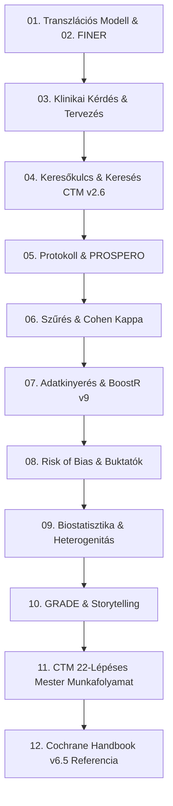

# CTM & Cochrane Kézikönyv — Módszertani Navigációs Index

> **Centre for Translational Medicine (CTM / Semmelweis Egyetem)**  
> **Cochrane Handbook for Systematic Reviews of Interventions v6.5 (2024)**  
> **PRISMA 2020 Nyilatkozat**  
> **Központi Wiki Portál:** [data/wiki/README.md](file:///c:/Users/shuba/Desktop/Researcher%20-%20D%C3%B3ri/data/wiki/README.md)

---

## 🏛️ A KANONIKUS 12 MÓDSZERTANI FEJEZET

### Részletes Módszertani Fejezetek:

1. **[01. A Transzlációs Medicina Modellje](file:///c:/Users/shuba/Desktop/Researcher%20-%20D%C3%B3ri/data/wiki/methodology/01_translational_medicine_model.md)**
   - A 4-elemes transzlációs ciklus: Healthcare ➔ Science ➔ Knowledge ➔ Communication.
   - Miért a szisztematikus áttekintés képezi a klinikai döntéshozatal és irányelvek alapját.

2. **[02. Témaválasztás & A FINER Keretrendszer](file:///c:/Users/shuba/Desktop/Researcher%20-%20D%C3%B3ri/data/wiki/methodology/02_topic_selection_finer.md)**
   - Feasible, Interesting, Novel, Ethical, Relevant validáció.
   - A 3-as Szenvedés Narratíva (Beteg morbiditás, Családi teher, Klinikai remény).

3. **[03. Klinikai Kérdés Keretrendszerek & Tanulmánytervezés](file:///c:/Users/shuba/Desktop/Researcher%20-%20D%C3%B3ri/data/wiki/methodology/03_clinical_question_frameworks.md)**
   - A 7 kanonikus keretrendszer: PICO (Intervenció), PECO / PEO (Etiológia/Prognózis), PFO (Predikció), CoCoPop (Prevalencia), PCC (Scoping), PICo (Kvalitatív).
   - Tanulmánytervek hierarchiája (RCT, prospektív és retrospektív kohorszok).
   - Széles (Broad) vs. Szűk (Narrow) fókusz; Lumping vs. Splitting heterogenitás-kezelés.

4. **[04. Szisztematikus Keresési Stratégia & Keresőkulcs Építés (CTM Guide v2.6)](file:///c:/Users/shuba/Desktop/Researcher%20-%20D%C3%B3ri/data/wiki/methodology/04_systematic_search_key_guide.md)**
   - Marie Anne Engh (CTM) hivatalos keresési útmutatója és a CTM 6-lépéses építési folyamata.
   - Kötelező adatbázisok: PubMed, Embase, Cochrane CENTRAL, ClinicalTrials.gov.
   - 5–10 korábbi metaanalízis precedens elemzésének szabálya.
   - ⛔ **Abszolút 'NOT' Tilalom:** Boole-operátor korlátozás.
   - Adatbázis-specifikus szintaxisok és beállítások (PubMed, Embase, CENTRAL, Scopus, Web of Science) és hibaelhárítás.

5. **[05. Protokoll Tervezés & PROSPERO Regisztráció](file:///c:/Users/shuba/Desktop/Researcher%20-%20D%C3%B3ri/data/wiki/methodology/05_protocol_and_prospero.md)**
   - Kötelező *a priori* regisztráció fizikailag az adatkinyerés megkezdése előtt.
   - Jelentési torzítások (Reporting Bias, Publication Bias, Time-Lag Bias) kivédése.

6. **[06. Tanulmányválogatás, Szűrés & Cohen's Kappa](file:///c:/Users/shuba/Desktop/Researcher%20-%20D%C3%B3ri/data/wiki/methodology/06_screening_and_selection.md)**
   - Két független bíráló (R1, R2) vak szűrése (Rayyan) és harmadik fél (R3) arbitrációja.
   - Inter-rater megbízhatóság mérése Cohen-féle Kappa együtthatóval.
   - CitationChaser másodlagos backward és forward hivatkozáskeresési hurok.

7. **[07. CTM Adatkinyerési & BoostR Útmutató (`Template v9`)](file:///c:/Users/shuba/Desktop/Researcher%20-%20D%C3%B3ri/data/wiki/methodology/07_data_extraction_and_boostr.md)**
   - A `Data_extraction_template_v9.xlsx` 14 specializált munkalapja.
   - BoostR 5-pontos ellenőrzőlista: Numeric-only, Author Year azonosító, hézagmentesség, egységes outcome címkék, mértékegység-konverziók.

8. **[08. Torzításkockázat (Risk of Bias) & Módszertani Buktatók](file:///c:/Users/shuba/Desktop/Researcher%20-%20D%C3%B3ri/data/wiki/methodology/08_risk_of_bias_and_pitfalls.md)**
   - Tanulmányterv-specifikus eszközök: RoB 2 (RCT), ROBINS-I (nem-randomizált), QUIPS (prognózis), QUADAS-2 (diagnosztika), JBI (prevalencia).
   - Traffic-light diagramok és robvis vizualizáció; Szenzitivitás-elemzési elvek.
   - A 3 Fő Buktató: Kauzális túlállítás (causal overreach), Hiányzó kovariánsok 70%-os feasibility szabálya, Ökológiai torzítás (Simpson-paradoxon).
   - Confounder Matrix és multivariábilis becslések prioritása.

9. **[09. Biostatisztikai Szintézis & Heterogenitás](file:///c:/Users/shuba/Desktop/Researcher%20-%20D%C3%B3ri/data/wiki/methodology/09_statistical_synthesis_and_heterogeneity.md)**
   - Poolability Rule: legalább 3 primer cikk azonos mérési végponttal.
   - Függő adatok kezelése: Multilevel Meta-Analysis (Robust Variance Estimation — RVE).
   - Heterogenitás értelmezése ($I^2$, $\tau^2$, Cochran Q) és Trial Sequential Analysis (TSA).

10. **[10. GRADE Bizonyítékértékelés & 6-Mondatos Storytelling](file:///c:/Users/shuba/Desktop/Researcher%20-%20D%C3%B3ri/data/wiki/methodology/10_grade_and_storytelling.md)**
    - CTM 6-mondatos strukturált absztrakt és eredményközlési formula.
    - GRADE megközelítés: Summary of Findings (SoF) táblázatok le- és felminősítési szabályai.

11. **[11. A CTM 22-Lépéses Mester Munkafolyamat & Moodle Kurrikulum](file:///c:/Users/shuba/Desktop/Researcher%20-%20D%C3%B3ri/data/wiki/methodology/11_ctm_22_step_master_workflow.md)**
    - Governance: Senior Methodology Supervisor (SMS), Statisztikus, Témavezető (PI), R1 & R2 bírálók.
    - A 8 kötelező SMS mérföldkő kapu a megvalósíthatóságtól a publikációig.
    - A teljes 22-lépéses hivatalos Semmelweis CTM Moodle tananyag (45 oldal) részletes moduljai.

12. **[12. Cochrane Handbook v6.5 Részletes Referencia](file:///c:/Users/shuba/Desktop/Researcher%20-%20D%C3%B3ri/data/wiki/methodology/12_cochrane_handbook_v6_5_reference.md)**
    - Részletes fejezeti bontás a Cochrane kézikönyv 1–26. fejezetei alapján, ágens direktívákkal.
