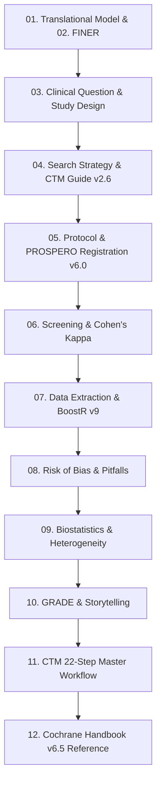

# CTM & Cochrane Handbook — Methodology Navigation Index

> **Centre for Translational Medicine (CTM / Semmelweis University)**  
> **Cochrane Handbook for Systematic Reviews of Interventions v6.5 (2024)**  
> **PRISMA 2020 Statement**  
> **Central Wiki Portal:** [data/wiki/README.md](file:///c:/Users/shuba/Desktop/Researcher%20-%20D%C3%B3ri/data/wiki/README.md)

---

## 🏛️ The 12 Canonical Methodology Chapters

### Detailed Methodology Chapters:

1. **[01. The Translational Medicine Model](file:///c:/Users/shuba/Desktop/Researcher%20-%20D%C3%B3ri/data/wiki/methodology/01_translational_medicine_model.md)**
   - The 4-element translational cycle: Healthcare ➔ Science ➔ Knowledge ➔ Communication.
   - Why systematic reviews form the foundation of clinical decision-making and guideline creation.

2. **[02. Topic Selection & The FINER Framework](file:///c:/Users/shuba/Desktop/Researcher%20-%20D%C3%B3ri/data/wiki/methodology/02_topic_selection_finer.md)**
   - Feasible, Interesting, Novel, Ethical, Relevant validation.
   - The Suffering Narrative triad (Patient Morbidity, Family Burden, Clinical Hope).

3. **[03. Clinical Question Frameworks & Study Design](file:///c:/Users/shuba/Desktop/Researcher%20-%20D%C3%B3ri/data/wiki/methodology/03_clinical_question_frameworks.md)**
   - The 7 canonical frameworks: PICO (Intervention), PECO / PEO (Etiology/Prognosis), PFO (Prediction), CoCoPop (Prevalence), PCC (Scoping), PICo (Qualitative).
   - Hierarchy of clinical study designs (RCT, prospective, and retrospective cohorts).
   - Broad vs. Narrow scope trade-offs; Lumping vs. Splitting heterogeneity management.

4. **[04. Systematic Search Strategy & Search Key Construction (CTM Guide v2.6)](file:///c:/Users/shuba/Desktop/Researcher%20-%20D%C3%B3ri/data/wiki/methodology/04_systematic_search_key_guide.md)**
   - Official search guide by Marie Anne Engh (CTM) and the 6-step construction process.
   - Mandatory databases: PubMed, Embase, Cochrane CENTRAL, ClinicalTrials.gov.
   - Precedent mining rule: extraction from 5–10 previous meta-analyses.
   - ⛔ **Absolute 'NOT' Ban:** Strict Boolean operator restriction.
   - Database-specific syntax rules, field tags, and troubleshooting.

5. **[05. Protocol Design & PROSPERO Registration Guide (CTM v6.0/v6.1)](file:///c:/Users/shuba/Desktop/Researcher%20-%20D%C3%B3ri/data/wiki/methodology/05_protocol_and_prospero.md)**
   - Mandatory *a priori* public registration strictly before screening and extraction begin.
   - Prevention of reporting biases (Publication, Time-Lag, Location, Citation, Language, and Selective Reporting Bias).
   - Click-by-click CTM operational guide for Screens 1–6 and the 12 canonical PROSPERO protocol sections.
   - Rejection trap prevention: student project flag alert, mandatory "Intervention review" type, and stage grid "Not started" mandate.
   - CTM institutional governance: shared SMS account credentials and mandatory pre-submission SMS signoff.
   - Ready-to-use markdown draft template: [`PROSPERO_REGISTRATION_TEMPLATE.md`](file:///c:/Users/shuba/Desktop/Researcher%20-%20D%C3%B3ri/data/wiki/templates/PROSPERO_REGISTRATION_TEMPLATE.md).
   - Full official markdown guide: [`PROSPERO_REGISTRATION_GUIDE_v6.1.md`](file:///c:/Users/shuba/Desktop/Researcher%20-%20D%C3%B3ri/data/wiki/resources/PROSPERO_REGISTRATION_GUIDE_v6.1.md).

6. **[06. Study Selection, Screening & Cohen's Kappa](file:///c:/Users/shuba/Desktop/Researcher%20-%20D%C3%B3ri/data/wiki/methodology/06_screening_and_selection.md)**
   - Dual independent blinded screening (Reviewers R1 & R2) in Rayyan with third-reviewer (R3) arbitration.
   - Inter-rater agreement quantification via Cohen's Kappa coefficient.
   - CitationChaser secondary backward and forward citation snowballing loop.

7. **[07. CTM Data Extraction & BoostR Guide (`Template v9`)](file:///c:/Users/shuba/Desktop/Researcher%20-%20D%C3%B3ri/data/wiki/methodology/07_data_extraction_and_boostr.md)**
   - Complete breakdown of the 14 specialized worksheets in `Data_extraction_template_v9.xlsx`.
   - BoostR 5-point data hygiene checklist: Numeric-only, unique Author Year IDs, gap-free matrices, standardized outcome naming, explicit unit conversions.

8. **[08. Risk of Bias Appraisal & Methodological Pitfalls](file:///c:/Users/shuba/Desktop/Researcher%20-%20D%C3%B3ri/data/wiki/methodology/08_risk_of_bias_and_pitfalls.md)**
   - Design-specific appraisal tools: RoB 2 (RCTs), ROBINS-I (non-randomized trials), QUIPS (prognosis), QUADAS-2 (diagnostic accuracy), JBI (prevalence).
   - Traffic-light charts and robvis summary plots; sensitivity analysis principles.
   - The 3 Major Pitfalls: Causal overreach, the 70% missing covariate feasibility rule, and Ecological Bias (Simpson's Paradox).
   - Confounder Matrix construction and prioritization of multivariable adjusted estimates.

9. **[09. Biostatistical Synthesis & Heterogeneity](file:///c:/Users/shuba/Desktop/Researcher%20-%20D%C3%B3ri/data/wiki/methodology/09_statistical_synthesis_and_heterogeneity.md)**
   - Feasibility Poolability Rule: minimum of 3 primary studies reporting identical outcomes.
   - Correlated and multi-timepoint data handling: Multilevel Meta-Analysis (Robust Variance Estimation — RVE).
   - Quantitative heterogeneity assessment ($I^2$, $\tau^2$, Cochran's Q) and Trial Sequential Analysis (TSA).

10. **[10. GRADE Evidence Appraisal & 6-Sentence Storytelling](file:///c:/Users/shuba/Desktop/Researcher%20-%20D%C3%B3ri/data/wiki/methodology/10_grade_and_storytelling.md)**
    - CTM 6-sentence structured abstract and translational communication formula.
    - GRADE framework: Summary of Findings (SoF) tables, downgrading and upgrading criteria, PRISMA 2020 reporting.

11. **[11. The CTM 22-Step Master Workflow & Moodle Curriculum](file:///c:/Users/shuba/Desktop/Researcher%20-%20D%C3%B3ri/data/wiki/methodology/11_ctm_22_step_master_workflow.md)**
    - Institutional governance: Senior Methodology Supervisor (SMS), Biostatistician, Principal Investigator, and R1/R2 reviewers.
    - The 8 mandatory SMS milestone gates from initial feasibility to journal publication.
    - The complete 22-step Semmelweis CTM Moodle curriculum (comprehensive 45-page reference).

12. **[12. Cochrane Handbook v6.5 Comprehensive Reference](file:///c:/Users/shuba/Desktop/Researcher%20-%20D%C3%B3ri/data/wiki/methodology/12_cochrane_handbook_v6_5_reference.md)**
    - Detailed chapter-by-chapter reference guide spanning Cochrane Handbook Chapters 1–26 with autonomous agent directives.
