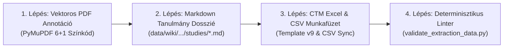

# AUDIT ÉS MŰSZAKI SPECIFIKÁCIÓ: AZ ADATKINYERÉSI FOLYAMAT ÉS AZ ANCHOR MOTOR (ANCHOR ENGINE)

> **Célközönség:** Külső Mesterséges Intelligencia ágensek, szoftverarchitektek és orvosbiológiai kutatók  
> **Szabványok:** Cochrane Handbook v6.5 (Chapter 5) · Centre for Translational Medicine (CTM) Template v9 & BoostR · PRISMA 2020  
> **Rendszer:** GP3 Medical Research Pipeline (`meta_hyperglycaemia` projekt)  
> **Dátum:** 2026-10-01 (Verzió: 1.1 — Szigorított módszertani szerződés)  
> **Fájl elérési út:** `docs/audit_and_universal_anchor_spec.md`

---

## 1. VEZETŐI ÖSSZEFOGLALÓ & RENDSZERKONTEXTUS (EXECUTIVE SUMMARY)

### 1.1 Mi a feladat?
A **GP3 Medical Research Pipeline** egy orvostudományi szisztematikus áttekintő és metaanalízis-készítő rendszer. A jelenlegi fázis célja primer klinikai közleményekből (kiadói PDF-ekből) kinyerni a számszerű adatokat (populáció $N$, eseményszámok $n$, átlagok, SD, korrigált esélyhányadosok aOR és 95% konfidenciaintervallumok), majd ezeket átvezetni a Semmelweis CTM által hitelesített Excel munkafüzetbe (`Data_extraction_template_v9.xlsx`) és géppel olvasható CSV-be statisztikai szintézis céljából.

### 1.2 Miért kritikus a megbízhatóság?
A biostatisztikai szintézisek leggyakoribb és legsúlyosabb hibája a **„Csendes Átírási Hiba” (Silent Transcription Error)**. Ha egy kutató vagy AI tévesen egy szomszédos sorból vagy oszlopból másol ki egy számot (pl. anyai szülészeti előzményt az újszülött halálozási száma helyett), de a szám matematikai formátuma helyes, a statisztikai szoftverek (R `metafor`, RevMan) hibajelzés nélkül lefutnak rajta. Ennek következménye téves orvosi irányelv, hibás klinikai döntéshozatal és végső soron a cikk visszavonása (retraction).

Ez a dokumentum bemutatja:
1. A **jelenlegi folyamat auditját** (erősségek, hibák, korlátok és a tanulságul szolgáló „Perez Paritás Bug”).
2. Az **Anchor Motor (Anchor Engine)** specifikációját, amely geometriai, hierarchikus és matematikai kényszerekkel garantálja a transzkripciós hibák kiszűrését.

---

## 2. A JELENLEGI FOLYAMAT AUDITJA (STATUS QUO AUDIT)

A rendszerben a felhasználói visszajelzés alapján bevezetésre került a **szigorú 4-lépéses kanonikus kinyerési lánc**:



### 2.1 A jelenlegi állapot erősségei
1. **Szigorú sorrendiség:** Az adatok forrása a PDF. Nincs adatbevitel az Excelbe anélkül, hogy az adat ne létezne a PDF-en kiemelve és az MD dossziéban dokumentálva.
2. **6+1 Kanonikus Színkód Palette:**
   - 🟡 `POPULATION_DEMO`: Gesztációs kor, születési súly, mintanagyság, Sarnat súlyossági stádium.
   - 🟢 `INTERVENTION_EXPOSURE`: Hiperglikémia definíció és határérték (pl. $>200\text{ mg/dL}$).
   - 🟣 `COMPARATOR_CONTROL`: Normoglikémia referencia tartomány (pl. $50-200\text{ mg/dL}$).
   - 🔵 `OUTCOME_EVENTS`: Halálozás, görcsök, cerebrális parézis, összetett kimenetelek.
   - 🟠 `STAT_EFFECT_ESTIMATE`: aOR, aRR, 95% CI, p-értékek, regressziós béták.
   - 🔴 `ROB_ATTRITION`: Lemorzsolódás (Lost to follow-up), hiányzó adatok.
   - ⚪ `AMBIGUOUS_UNCONFIRMED`: Tisztázatlan, ellentmondásos adatok (emberi feloldást igényel).
3. **Determinisztikus Ellenőrzés:** A `src/validate_extraction_data.py` linter 5 kapun keresztül ellenőrzi az Excel táblát (Numeric-only, Math logic, Author_Year, Taxonomy, Units), és a jelenlegi 3 cikkre **100 / 100 pontot** ad.

---

### 2.2 A korábbi hiba részletes esettanulmánya: A „Perez Maternal Parity Bug”

> [!CAUTION]
> **A hiba leírása:** A `Perez et al. (2023)` tanulmány feldolgozásakor a halálozási eseményszám ($29$) helyett a szülészeti paritás sora került vizuális kiemelésre a PDF-ben!

#### Miért történt ez? (Gyökérok-elemzés / Root Cause Analysis)
1. **Többoldalas Táblázat-széttörés (Multi-page Table Split):**
   - A tanulmány 1. táblázata (`Table 1`) két egymást követő oldalon terült el:
     - **5. oldal:** Anyai és kiindulási demográfia (Anyai életkor, paritás, szülés módja).
     - **6. oldal:** Újszülöttkori kimenetelek (`Table 1 Continued`: Halálozás, NDI, görcsök).
2. **Homoritmikus Számok (Homonym Data in Disparate Rows):**
   - Az 5. oldalon az *„Anyai paritás = 2”* sor hiperglikémiás oszlopában a következő érték szerepelt: `29 (26.1)`.
   - A 6. oldalon a tényleges *„Halálozás (Death)”* sor hiperglikémiás oszlopában **pontosan ugyanez a szám szerepelt**: `29 (26.1)` ($29/111 = 26.1\%$).
3. **Naiv String-alapú Keresés (Unbounded Text Search):**
   - A korábbi kód így kereste a számot: `page.search_for("29 (26.1)")`.
   - Mivel a kereső nem tudta, hogy a táblázat fejlécétől vertikálisan mekkora távolságra van a sor, és nem vizsgálta a sor bal szélén lévő címkét (`Death` vs. `Maternal parity`), a legelső találatot jelölte meg az 5. oldalon!
4. **Izolált Szöveges Redundancia (Basu 2017):**
   - A `Basu 2017` cikkben a `normoglycaemia` kifejezés **5 különböző helyen** fordult elő a 2. oldalon (címben, bevezetőben, összefoglalóban, módszertani definícióban). A naiv kereső mind az 5 helyre elhelyezte a lila kiemelést.

---

## 3. AZ ANCHOR MOTOR (ANCHOR ENGINE) SPECIFIKÁCIÓJA

## 3.2 Az Anchor Motor 4 Pillére (javított)

A motor négy független kényszert alkalmaz minden adatponton. A kényszerek **különböző hibatípusokat** fognak meg, ezért egyik sem helyettesíti a másikat. A motor célja a **rossz cellából való olvasás** és az **átírási hiba** kiszűrése, a kinyerési *döntések* helyességét nem garantálja (lásd 4. fejezet).

| Pillér | Mit fog meg | Mit NEM fog meg |
|---|---|---|
| 1. Hierarchikus 2D horgony | Rossz sor vagy oszlop (pl. Perez paritás-hiba), oldalak közötti keveredés | Hibásan megadott lekérdezés |
| 2. Matematikai checksum | Elgépelés (`21.6` vs `26.1`), rossz nevező | Rossz sor azonos n és N mellett |
| 3. Szemantikai triád | Kimenetel-keveredés folyószövegben | Összetett vagy implicit kontrasztok |
| 4. Geometriai lábnyom | Utólagos módosítás, hiányzó visszakereshetőség | Annak igazolása, hogy a doboz a helyes cellát fogja körül |
| Ábra-digitalizálás | Tengelykalibráció + szöveges kereszt-ellenőrzés | Azt nem, hogy a jelölő a helyes sorozathoz tartozik-e (⚪/emberi ellenőrzés) |

---

### Pillér 1: Hierarchikus 2D Mátrix Horgony és Oszlopcsatorna-Átörökítés

#### A. A Breadcrumb Elérési Út
Minden táblázatos cella egyértelműen azonosítandó a sor- és oszlophierarchia teljes fájával:
$$\text{Cell Address} = \langle \text{Table ID} \rangle \times \langle \text{Row Breadcrumb} \rangle \times \langle \text{Column Breadcrumb} \rangle$$

*Példa Perez Sarnat 3 kiemelésre:*
- `Table ID`: `Table 1`
- `Row Breadcrumb`: `Worst Sarnat stage -> Severe`
- `Column Breadcrumb`: `Therapeutic Hypothermia -> Hyperglycemia (>200 mg/dL) -> n (%)`

#### B. Többoldalas Vertikális Csatorna-Átörökítés (Vertical Coordinate Channel Projection)
Amikor a táblázat átnyúlik a következő oldalra:
1. A rendszer az 1. oldalon detektálja az oszlopfejlécek vízszintes kiterjedését:
   $$\text{Channel}_{\text{Hyperglycemia}} = [x_{\min} = 452.0\text{ pt},\ x_{\max} = 518.0\text{ pt}]$$
2. Ezt a koordináta-csatornát **átvetíti a 2. oldalra**.
3. A 2. oldalon megkeresi a `Death` sorfejléc vertikális kiterjedését:
   $$\text{Band}_{\text{Death}} = [y_{\min} = 413.0\text{ pt},\ y_{\max} = 422.0\text{ pt}]$$
4. **Metszet Képzése:**
   $$\text{Target Bounding Box} = \text{Channel}_{\text{Hyperglycemia}} \cap \text{Band}_{\text{Death}} = [452.0, 413.0, 518.0, 422.0]$$
5. A rendszer **kizárólag ebben a téglalapban** engedélyezi a szám kiolvasását.
   - Az 5. oldali paritás ($y = 448.1$ az 5. oldalon) fizikailag nem kaphat találatot, mert a 6. oldalon keresünk!
   - A 6. oldali szomszédos Euglycemia érték (`18 (6.4)`, $x \in [380, 440]$) fizikailag kiesik a csatornából!

---

### Pillér 2 pontosítása: mit véd és mit nem

A checksum az `n (%)` cella belső konzisztenciáját és a nevező helyességét ellenőrzi. Ezt a Perez-hibára **nem szabad hivatkozni védelemként**: a paritássor és a halálozássor egyaránt `29 (26.1)` volt, ugyanazzal az N=111 nevezővel, így a checksum mindkettőre PASS-t adna. A rossz sor kizárása kizárólag az 1. pillér feladata. A checksum a következő esetekben dob hibát: elgépelt érték, rossz csoportnevező, hibás százalékérték.

$$\text{Expected Pct} = \frac{n}{N} \times 100$$
$$\Delta = |\text{Reported Pct} - \text{Expected Pct}| \le 0.2\%$$
Ha $\Delta > 0.2\%$, a rendszer azonnal `MathChecksumError` kivételt dob.

A nevező (N) maga is parsing eredmény (fejlécből vagy `n =` jelölésből). Ezért a motor az N-t külön horgonyozza (saját bounding box, saját forrás), és ha az N nem olvasható ki egyértelműen, a checksum nem fut le, a cella ⚪ `AMBIGUOUS_UNCONFIRMED` jelölést kap.

---

### Pillér 3 pontosítása: konzervatív viselkedés

A szemantikai triád (kimenetel + becslőtípus + érték és CI) szükséges, de nem elégséges feltétel. Kétértelmű esetben a motor **nem dönt**:

- Ha az ablakban több kimenetel is szerepel, és a hozzárendelés nem egyértelmű szintaktikai mintával (pl. `X (aOR …), but not Y`) oldható fel → **⚪ `AMBIGUOUS_UNCONFIRMED`**.
- Ha több aOR vagy CI szerepel az ablakban → ⚪.
- Ha a mondat modellre utal (nyers vs. korrigált, részminta), amit a specifikáció nem azonosított → ⚪.
- A felismert negációs és kontrasztminták listája verziózott, és minden új minta teszteset nélkül nem kerülhet be.

Minden ⚪ tétel emberi döntésre kerül, és nem kerülhet az Excelbe, amíg fel nem oldják.

---

### Pillér 4 pontosítása: tamper-evidence

A `context_sha256` a bounding box és a környezeti szöveg lenyomata. Célja a **manipuláció-észlelés** és az auditálhatóság: kiderül, ha a dosszié és a PDF közötti kapcsolat utólag megváltozott. A hash **nem bizonyítja**, hogy a téglalap a helyes cellát fogja körül; ezt az 1. pillér és az emberi vizuális ellenőrzés adja.

```json
{
  "study_id": "Perez_2023",
  "variable_canonical": "mortality_hyperglycemia_events",
  "extracted_value": 29,
  "reported_representation": "29 (26.1)",
  "page_number": 6,
  "bounding_box": [478.2, 413.8, 518.5, 421.7],
  "anchor_type": "TABULAR_2D_INTERSECTION",
  "headers": {
    "table": "Table 1 (Continued)",
    "row_hierarchical": ["Outcomes", "Death"],
    "col_hierarchical": ["Therapeutic Hypothermia", "Hyperglycemia (>200 mg/dL)", "n (%)"]
  },
  "mathematical_checksum": {
    "numerator": 29,
    "denominator": 111,
    "calculated_pct": 26.13,
    "reported_pct": 26.1,
    "status": "VERIFIED_PASS"
  },
  "context_sha256": "4a7f28bc9d1e...3b"
}
```

---

### 3.3 Hibamódok és kötelező viselkedés (fail loudly)

A motor soha nem folytathatja csendben, ha a bemenet nem egyértelmű.

| Hibamód | Kötelező viselkedés |
|---|---|
| A `clip` téglalap üres szöveget ad | Kivétel (`EmptyCellError`), nem üres string |
| A `clip` több számot tartalmaz | Kivétel (`AmbiguousCellError`) vagy ⚪ |
| Egyesített (merged) vagy többsoros fejléc | A breadcrumb nem állítható össze egyértelműen → ⚪ |
| Kétoszlopos oldalelrendezés, felborult olvasási sorrend | Koordináta-alapú (nem sorrend-alapú) kinyerés; ha nem lehetséges → ⚪ |
| Elforgatott (landscape) táblázat | Rotációs normalizálás; sikertelenség esetén leállás |
| Szkennelt oldal (nincs szövegréteg) | A motor nem fut; manuális kinyerés jelölése |
| A számjegyek részben kívül esnek a `clip`-en | A téglalap egy fix margóval bővítve újraolvasva; eltérés esetén leállás |
| Az oszlopcsatorna két oldalon eltérő x-tartományú | Az átörökítés megáll; a csatornát újra kell detektálni a fejléc-ismétlődésből |
| A sorfejléc kétszer fordul elő az oldalon | Leállás, a lekérdezést pontosítani kell (breadcrumb szülővel) |

---

### 3.4 Kötelező tesztterv

A motor csak akkor tekinthető működőnek, ha az alábbi tesztek mind lefutnak:

1. **Pozitív teszt:** Perez halálozás → 6. oldal, `29 (26.1)`, checksum PASS.
2. **Negatív teszt (sor):** ugyanaz az oszlop, de a paritássor lekérdezése esetén a motor a **sor-címkén** bukik el, vagy más cellát ad vissza. Ha a paritásra is a halálozás eredménye jönne, a motor nem old meg semmit.
3. **Szomszédos oszlop:** az Euglycemia `18 (6.4)` cella semmilyen lekérdezéssel nem olvasható ki a Hyperglycemia csatornából.
4. **Mutációs tesztek:** rossz nevező (111 helyett 98) és elgépelt szám (`21.6`) → `MathChecksumError`.
5. **Fail-loud tesztek:** a 3.3 táblázat minden sorára legalább egy szintetikus teszteset.
6. **Regresszió:** a három meglévő cikk minden kinyert értéke egyezik a jelenlegi Excel-értékekkel.
7. **Általánosíthatóság:** legalább 5–10 további, eltérő kiadói elrendezésű PDF (kétoszlopos, landscape táblázat, lábjegyzetes). A "universal" elnevezés csak ennek teljesülése után használható; addig a modul neve `anchor_engine` (kísérleti).

---

## 3.5 Ábrákból történő adatkinyerés (Plot Digitizer modul)

Számos közleményben a hatásbecslés, az eseményidő vagy az átlag csak ábrán szerepel (forest plot, Kaplan-Meier-görbe, oszlop- vagy dobozdiagram, szórásdiagram). Ezekre a 1-3. pillér nem alkalmazható közvetlenül, mert nincs sor-oszlop mátrix és nincs `n (%)` checksum. Ez a szakasz egy külön modult ír le (`src/figure_digitizer.py`, kísérleti), amely a WebPlotDigitizerhez hasonló kalibrációs elvvel dolgozik, de a pipeline auditálhatósági követelményeit is teljesíti.

### 3.5.1 Alapelv: a digitalizált érték becslés, nem leolvasott érték

A táblázatból kiolvasott szám pontos, az ábráról leolvasott szám **mérési eredmény bizonytalansággal**. Ezért:

- minden digitalizált adatpont kötelezően a `DIGITIZED` jelzőt kapja a dossziéban és az Excelben (külön oszlop vagy megjegyzés), és a becsült bizonytalanságát is tárolni kell;
- ha ugyanaz az érték a szövegben vagy táblázatban is szerepel, **mindig az közölt érték élvez elsőbbséget**, a digitalizált csak ellenőrzésre szolgál;
- a digitalizált adatok a szintézisben külön jelölendők, és érzékenységi elemzésben (digitalizált adatok nélkül) is szerepeltetendők. Ez a Cochrane-féle átláthatósági elvvel is összhangban van.

### 3.5.2 Két működési mód: vektoros és raszteres ábra

| | Vektoros ábra (PDF-be ágyazott ábra) | Raszteres ábra (beágyazott kép, szkennelt oldal) |
|---|---|---|
| Forrás | `page.get_drawings()` útvonalak és `get_text("dict")` tengelycímkék | Pixeltömb |
| Pontosság | Gyakorlatilag pontos (a PDF-ben tárolt koordináták), korlátja a kalibráció | Pixelfelbontás által korlátozott, tipikusan a tengelytartomány ~0,5-1%-a |
| Módszer | Útvonal- és jelölőpont-koordináták átszámítása | Színalapú vagy kontúralapú szegmentálás, majd átszámítás |
| Bizonytalanság | Kalibrációs maradék | Kalibrációs maradék + 1-2 pixel kvantálás + szegmentálási hiba |

A modul **először mindig a vektoros utat próbálja**, mert ez nagyságrendekkel pontosabb. Raszteres módban a bizonytalanságot az adatpont mellé kötelezően ki kell számolni (pixel → mértékegység).

### 3.5.3 A digitalizálás lépései

**1. Ábra azonosítása és horgonyzása.** Az ábra egyértelmű azonosítója: oldal, bounding box, ábrafelirat (pl. `Figure 4B`). Ez a 1. pillér megfelelője: az adatpont címkéje az ábraszám, panel és sorozat.

**2. Tengelykalibráció.**
- A tengelycímkék számértékeit (vektoros esetben a szövegrétegből) és a hozzájuk tartozó pixel-/pont-koordinátákat párosítjuk.
- Lineáris, logaritmikus (forest plotnál jellemző) vagy idő tengelytípus megadása kötelező, nem találgatható.
- **Legalább 3 kalibrációs pont** szükséges tengelyenként (a 2 pont mindig tökéletesen illeszkedik, így nem ad ellenőrzést). A maradékhiba (residual) a tengelytartomány meghatározott százalékát (javaslat: 0,5%) nem haladhatja meg, különben leállás.
- Forgatott vagy torzított ábra esetén normalizálás, sikertelenség esetén leállás.

**3. Sorozat-azonosítás.** A sorozatot (pl. hipergilkémiás vs. normoglikémiás csoport) a jelmagyarázatból (szín, jelölő, vonalstílus) kell párosítani. Ha két sorozat színe a szegmentálás szempontjából nem elkülöníthető, vagy a jelmagyarázat hiányzik, a pont ⚪ `AMBIGUOUS_UNCONFIRMED` jelölést kap.

**4. Pontkinyerés típusonként.**

| Ábratípus | Kinyerendő | Megjegyzés |
|---|---|---|
| Forest plot | pontbecslés, alsó és felső CI-határ | Logaritmikus tengely; a jobb oldali szöveges oszlop (ha van) elsődleges forrás |
| Oszlopdiagram, hibasáv | átlag, hibasáv vége | A hibasáv típusa (SD, SE, 95% CI) nem következtethető az ábrából, **a feliratból vagy a módszertanból kell azonosítani**, különben ⚪ |
| Dobozdiagram | medián, kvartilisek, tartomány | Átlag és SD becsléséhez külön, dokumentált módszer kell (pl. Wan és mtsai, Luo és mtsai); a módszer megnevezése kötelező |
| Kaplan-Meier-görbe | (idő, túlélés) pontok, a veszélyeztetett számok táblázata | Egyéni betegszintű adat rekonstrukciója csak a veszélyeztetett számokkal együtt, dokumentált algoritmussal (pl. Guyot és mtsai, 2012) |
| Szórásdiagram, idősor | egyedi pontok | Átfedő pontoknál ⚪ |

**5. Átszámítás és bizonytalanság.** Az adatpont értéke a kalibrációs transzformáción át számolódik, a bizonytalanság a kalibrációs maradékból és (raszteres módban) a pixelkvantálásból adódik.

### 3.5.4 Ellenőrzési kényszerek (a 2. pillér megfelelője)

Itt nincs `n/N` checksum, ezért más kereszt-ellenőrzések szolgálnak védelemül:

1. **Szöveggel való keresztellenőrzés:** ha a hatásbecslés a szövegben is szerepel, a digitalizált érték a közölt érték kvantálási bizonytalanságán belül kell hogy legyen. Eltérés esetén leállás és emberi felülvizsgálat.
2. **Belső konzisztencia forest plotnál:** a pontbecslés a CI-n belül van, és logaritmikus skálán megközelítőleg a határok mértani közepén (aszimmetria esetén jelzés). Ha p-érték vagy SE is közölt, ellenőrizhető a CI-vel.
3. **Eseményszám és arány:** KM-görbénél a rekonstruált összesített eseményszám az ábrán/szövegben közölt eseményszámmal egyezzen.
4. **Tartományellenőrzés:** a kinyert érték a biológiailag/logikailag lehetséges tartományban legyen (pl. túlélés 0-1 között, arány 0-100%).
5. **Ismételt kinyerés:** kulcsadatoknál a digitalizálást egy második futtatás (vagy második ember) függetlenül megismétli, és a két érték eltérése a megadott tűrésen belül kell hogy legyen. Itt a kettős kinyerés **indokolt marad**, mert a digitalizálás ítéleti elemeket tartalmaz (jelölő középpontja, vonal éle).

### 3.5.5 Rögzített adatstruktúra

```json
{
  "study_id": "Perez_2023",
  "variable_canonical": "mortality_aOR_hyperglycemia",
  "extracted_value": 2.52,
  "value_origin": "DIGITIZED",
  "figure": {
    "label": "Figure 4B",
    "page_number": 8,
    "figure_bbox": [60.0, 120.0, 540.0, 420.0],
    "mode": "VECTOR",
    "series": "Hyperglycemia vs Normoglycemia",
    "chart_type": "FOREST_PLOT"
  },
  "calibration": {
    "x_axis": {
      "scale": "log",
      "reference_points": [
        {"value": 0.5, "coord": 212.4},
        {"value": 1.0, "coord": 268.9},
        {"value": 4.0, "coord": 381.7}
      ],
      "max_residual_pct_of_range": 0.12
    }
  },
  "estimate": {"point": 2.52, "ci_low": 1.10, "ci_high": 5.77},
  "uncertainty": {"absolute": 0.01, "source": "calibration_residual"},
  "cross_check": {
    "text_reported": "aOR 2.52; 95% CI 1.10-5.77",
    "within_tolerance": true,
    "status": "VERIFIED_AGAINST_TEXT"
  },
  "human_confirmation": {"reviewer": null, "timestamp": null, "status": "PENDING"},
  "context_sha256": "..."
}
```

Az érték ebben a példában szándékosan megegyezik a korábbi szöveges példával: ez mutatja, hogy a szöveg az elsődleges forrás, az ábra pedig kereszt-ellenőrzés.

### 3.5.6 Hibamódok és kötelező viselkedés

| Hibamód | Kötelező viselkedés |
|---|---|
| Kevesebb mint 3 kalibrációs pont | Leállás |
| Kalibrációs maradék a küszöb felett | Leállás |
| Tengelytípus (lineáris/log) nem egyértelmű | Leállás, a típus manuális megadása |
| Megszakított (axis break) vagy kettős tengely | ⚪, manuális kalibráció dokumentálva |
| Hibasáv típusa nem azonosítható | ⚪, a szintézisbe nem kerülhet |
| Átfedő pontok vagy sorozatok | ⚪ |
| Tömörítési műtermékek, alacsony felbontás | A bizonytalanság kiszámolása; küszöb felett ⚪ |
| Digitalizált és közölt érték eltér | Leállás, emberi döntés; a közölt érték az elsődleges |
| Szkennelt/raszteres ábra szegmentálási hibával | Emberi javítás megengedett, de naplózva |

### 3.5.7 Emberi megerősítés

Digitalizált adatnál a vizuális ellenőrzés kötelező **minden** adatpontra (nem csak a kulcskimenetekre): a megjelenített kép az ábrát a rárajzolt kalibrációs pontokkal és a kinyert pontokkal mutatja. A megerősítés naplózott. Az indok: a digitalizálás bizonytalansága nagyobb, és a szegmentálási hibák vizuálisan gyorsan észrevehetők.

### 3.5.8 Tesztterv (kiegészítés a 3.4-hez)

1. **Szintetikus ábrák:** ismert értékekből generált vektoros és raszteres ábrák (lineáris és log tengely, forest plot, oszlop, KM). A kinyert értékek a megadott bizonytalanságon belül egyezzenek a generáló értékekkel.
2. **Valós ábra, ismert szöveges értékkel:** olyan ábrák, ahol a pontos érték a szövegben is megvan (pl. a Perez-ábra 4B), a keresztellenőrzés lefut és PASS.
3. **Negatív teszt:** szándékosan elrontott kalibráció (felcserélt tengelycímke, lineáris helyett log) → leállás.
4. **Eltérés-teszt:** szándékosan módosított szöveges érték → a modul eltérést jelez.
5. **Összehasonlítás WebPlotDigitizerrel:** legalább 10 ábrán az eredmények egyezzenek a WebPlotDigitizer kimenetével a tűrésen belül.
6. **Fail-loud tesztek:** a 3.5.6 táblázat minden sorára legalább egy szintetikus eset.

### 3.5.9 Illeszkedés a pipeline-ba

- A 6+1 színpaletta nem bővül: az ábrából kinyert adat a **tartalmi kategória színét** kapja (pl. 🟠 `STAT_EFFECT_ESTIMATE`), a digitalizált eredetet a **szaggatott körvonal** és a `DIGITIZED` jelző mutatja.
- A linter (`validate_extraction_data.py`) kapjon egy új kaput: `DIGITIZED` jelzőjű sor csak akkor megy át, ha van bizonytalansági érték, kereszt-ellenőrzési státusz és emberi megerősítés.
- A meta-analitikai szintézis bemenetében a digitalizált adatpontok külön jelölve szerepelnek, hogy az érzékenységi elemzés elvégezhető legyen.

### 3.5.10 Korlátok (a spec őszinte állításai)

- A digitalizálás **soha nem pontosabb**, mint a közölt számérték, és a modul nem állíthatja, hogy "100%-os integritást" ad: a garancia a kalibrációra és a kereszt-ellenőrzésre korlátozódik.
- A KM-görbékből rekonstruált egyéni betegszintű adat becslés, és az eredeti IPD helyett csak közelítés.
- A hibasáv típusának azonosítása és a dobozdiagram-átlag becslése módszertani döntés, amelyet független emberi ellenőrzésnek kell megerősítenie.
- A modul addig kísérleti (`figure_digitizer`), amíg a 3.5.8 tesztterv teljesen le nem futott.

---

## 4. A KETTŐS KINYERÉS SZEREPE: MIT VÁLT KI A MOTOR, ÉS MIT NEM

### 4.1 Két különböző feladat

A Cochrane Handbook (5. fejezet) szerinti kettős független kinyerés két különböző hibaforrást kezel:

1. **Transzkripciós hibák:** elgépelés, átugrott sor, rossz oszlopból másolás.
2. **Ítéleti hibák:** melyik kimenetel-definíció, időpont, modell (nyers vs. korrigált), elemzési populáció (ITT vs. per-protocol), melyik alcsoport tartozik az eredménybe.

### 4.2 Amit a motor kivált

A mechanikus, számról számra történő **kettős gépelés** (transzkripció) kiváltható, mert:

- az 1. pillér miatt a motor csak a megadott sor- és oszlopmetszetből olvas, a szomszédos cellákból nem;
- a 2. pillér az elgépelést és a nevezőhibát azonnal jelzi;
- a vizuális kiemelés lehetővé teszi, hogy az ember egy pillantással ellenőrizze a forrást, ne gépelje újra.

### 4.3 Amit a motor nem vált ki

A motor azt garantálja, hogy a **megadott lekérdezés cellájából** olvas. Ha maga a lekérdezés hibás (rossz sor, rossz modell, rossz időpont), a motor következetesen a rossz cellát olvassa, és minden kényszeren átmegy. Ezért az alábbiak **független második ellenőrzést** igényelnek:

- a lekérdezés-specifikáció (`row_query`, `col_query`, a használt modell és populáció) a **kulcskimeneteknél** (elsődleges kimenetelek és a metaanalízisbe bekerülő hatásbecslések);
- az összes ⚪ `AMBIGUOUS_UNCONFIRMED` tétel;
- minden olyan adatpont, ahol a cikk több lehetséges értéket közöl ugyanarra a kimenetre;
- **minden digitalizált adatpont** független emberi ellenőrzést igényel.

### 4.4 Kötelező emberi vizuális megerősítés

Minden kinyert adatpontnál az ellenőrző számára megjelenik:

- a PDF-oldal kivágata a kiemelt téglalappal, a hozzá tartozó **sorfejléccel és oszlopfejléccel együtt**;
- a motor által olvasott érték és a checksum eredménye.

A megerősítés (ellenőrző azonosítója, időpont, igen/nem) naplózásra kerül a dossziéban. Ez a Cochrane-féle második ellenőrzés olcsó, de védhető formája: az ellenőrzés tárgya a *lekérdezés helyessége*, nem a szám újragépelése.

### 4.5 Összefoglaló

| Hibaforrás | Védelem |
|---|---|
| Elgépelés, rossz cellába csúszás | Motor (1. és 2. pillér) |
| Rossz nevező | Motor (2. pillér, külön horgonyozott N) |
| Kimenetel-keveredés folyószövegben | Motor (3. pillér) + ⚪ eszkaláció |
| Hibás lekérdezés, rossz modell vagy időpont | Független emberi ellenőrzés |
| Kétértelmű vagy nem szabványos elrendezés | ⚪ jelölés, emberi döntés |
| Ábrából digitalizált adat | Kalibrációs ellenőrzés + szöveges kereszt-ellenőrzés + kötelező emberi megerősítés |

---

## 5. RENDSZERARCHITEKTÚRA ÉS IMPLEMENTÁCIÓS TERV

A kísérleti modul megnevezése: `src/anchor_engine.py` és `src/figure_digitizer.py` (az általánosíthatósági tesztek lefutásáig).

### 5.1 Adatfolyam és Modulok

```
                    ┌────────────────────────┐
                    │      Publisher PDF     │
                    └───────────┬────────────┘
                                │
                                ▼
         ┌───────────────────────────────────────────────┐
         │             Extraction Engines                │
         │ • src/anchor_engine.py (Table 2D Matrix)      │
         │ • src/figure_digitizer.py (Plot Calibration)  │
         │ • Math checksum & fail-loud error policies    │
         └──────────────────────┬────────────────────────┘
                                │
             ┌──────────────────┴──────────────────┐
             ▼                                     ▼
┌─────────────────────────┐           ┌─────────────────────────┐
│ Vector Annotated PDF    │           │ Study Markdown Dossier  │
│ (PyMuPDF Fitz 6+1)      │           │ (data/wiki/.../*.md)    │
└─────────────────────────┘           └────────────┬────────────┘
                                                   │
                                                   ▼
                                      ┌─────────────────────────┐
                                      │ CTM Template v9 & CSV   │
                                      │ (Excel & CSV Sync)      │
                                      └────────────┬────────────┘
                                                   │
                                                   ▼
                                      ┌─────────────────────────┐
                                      │ src/validate_extraction │
                                      │ (100/100 Linter Gate)   │
                                      └─────────────────────────┘
```

---

## 6. ÖSSZEGZÉS ÉS VERIFIKÁCIÓS IRÁNYELV (javított)

Ez a specifikáció a következőket állítja, és csak ezeket:

1. A korábbi naiv szövegkeresés azért bukott el, mert nem kötötte a találatot sor- és oszlopkontextushoz. A hierarchikus 2D horgony (1. pillér) ezt a hibaosztályt zárja ki a támogatott elrendezéseken.
2. A matematikai checksum (2. pillér) az átírási és nevezőhibákat fogja meg, a rossz sorból való olvasást nem.
3. A motor a **transzkripciós** kettős gépelést váltja ki. A kinyerési döntések (lekérdezés, modell, populáció) és a ⚪ esetek független ellenőrzése megmarad.
4. Minden bizonytalan helyzetben a motor leáll vagy ⚪ jelölést ad, és soha nem folytat csendben.
5. A motor érvényessége a 3.4 és 3.5.8 tesztterv teljesítésétől függ. A "universal" jelző a legalább 5–10 további, eltérő elrendezésű PDF-en való sikeres futás után használható.
6. **Az ábrából kinyert adat becslés**, mindig `DIGITIZED` jelzővel ellátva, és **sosem helyettesíti a közölt értéket**. Ha szöveges vagy táblázatos adat létezik, az élvez elsőbbséget.

A kinyert adatok visszakövethetősége (bounding box, hash, napló) támogatja a CTM- és Cochrane-megfelelést. Azt nem garantálja, hogy az adatok hibamentesek: a garancia a dokumentált hibamódokra és a tesztelt elrendezésekre korlátozódik.
